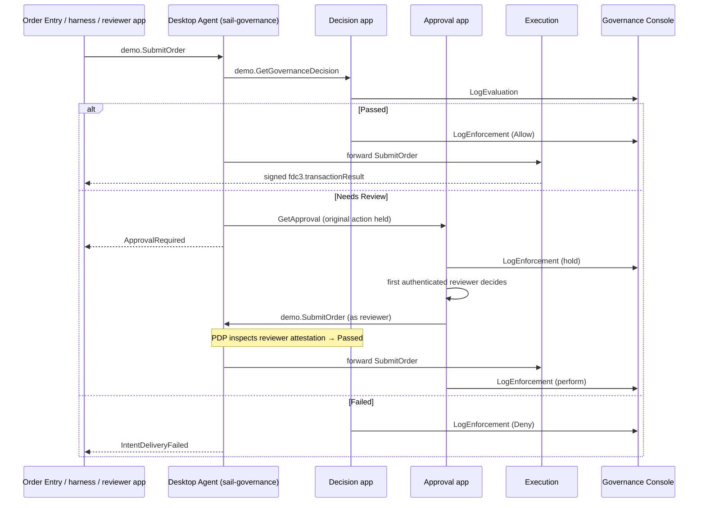
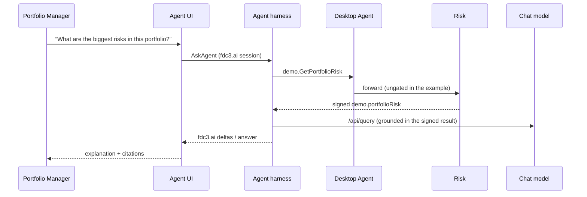

The [runnable example](https://github.com/finos/ten-factor-governance/blob/main/examples/aipa/)
under `examples/aipa/` is a local FDC3 desktop: specialist apps, an Agent UI +
harness, and a Governance Runtime assembled from a Desktop Agent enforcement
point, interchangeable decision apps, human-approval apps, and an evidence
console.

The [FINOS CALM](https://calm.finos.org) model at
[`examples/aipa/calm/architecture.json`](https://github.com/finos/ten-factor-governance/blob/main/examples/aipa/calm/architecture.json)
is the **target production architecture**. It places the same roles on Managed
Kubernetes hosts inside a banking firewall, with a Governance Gateway that
evaluates FDC3 intents **and** chat / model I/O, an Artifact Repository, a
Decisions and Evidence Record on object storage, and in-firewall foundation-model
inference. Gemara / CCC / AIGF / AIMS controls attach via node `controls` and
[`decorators/`](https://github.com/finos/ten-factor-governance/blob/main/examples/aipa/calm/decorators/).

```bash
npm run calm:validate
npm run calm:diagrams
```

For how the example runs locally, and how that maps onto the CALM hosts, see
[Deployment](./deployment). For intents and contexts see [FDC3](./fdc3-interop).

## Runnable desktop

`npm run aipa:dev` starts the App Directory, the specialist and governance
apps, and the Sail `sail-governance` host. Point [FDC3 Sail](https://github.com/finos/FDC3-Sail)
at `http://localhost:4099/static/generated/aipa-fdc3-apps.json`.

| Role | Apps | What they do |
| --- | --- | --- |
| Specialist | Portfolio, Risk, Research, Market Data, Order Entry, Execution | Deterministic portfolio, risk, research, prices, draft orders, and submit. Signed results where required. |
| Assistant | Agent UI, Agent harness, Markdown Viewer, Discoverability | Chat session (`AskAgent`), tool loop, markdown render, workspace catalog. |
| Enforcement | Sail `sail-governance` | Policy enforcement point. Intercepts `demo.SubmitOrder`, asks a PDP, maps `log.result`. |
| Decision | Direct governance or JEV governance | Policy decision point. Answers `demo.GetGovernanceDecision` (Passed / Needs Review / Failed). |
| Human approval | Approvals or Fluxnova | Hold `GetApproval`, authenticate the reviewer, record the first decision, re-raise `demo.SubmitOrder` as that reviewer. |
| Evidence | Governance Console | Appends `LogEvaluation` / `LogEnforcement` (Gemara layers 5 and 6). |

Observe → propose (`GetPortfolio`, `demo.GetPortfolioRisk`, `demo.GetResearch`,
`demo.CreateOrder`, …) is **ungated** in the example: the harness raises
specialist intents and the Desktop Agent forwards them. **Execute**
(`demo.SubmitOrder`) is the sensitive raise. That matches the
[demo steps](./demo-steps): 1–7a without governance, 7b with it on.

### Governance split

Raising apps and Execution stay approval-agnostic. They raise and handle
`demo.SubmitOrder` as usual. Policy is composed from four roles that different
apps can fill:

| Role | Behaviour | Example fill |
| --- | --- | --- |
| Enforcement point | Intercept the sensitive raise; apply the evaluation result; do not re-decide policy | `sail-governance` on Sail |
| Decision point | Inspect raise identity (trusted reviewer attestation), apply declared rules, return Passed / Needs Review / Failed | Direct (rule table) or JEV (`rules.json` scored on LM Studio System One) |
| Human approval | Hold the original action, present a worklist, bind the first decision to an authenticated reviewer, re-raise as that reviewer | Approvals stub or Fluxnova |
| Evidence store | Persist and present evaluation and enforcement receipts | Governance Console |

Sail settings split **Evaluation** (`off` / `direct` / `jev`) from **Approval**
(GetApproval app + approver). `log.result` mapping: **Passed** → forward,
**Needs Review** → raise `GetApproval` and return `ApprovalRequired` to the
raiser, **Failed** → `IntentDeliveryFailed`. Missing PDP, timeout, or a
malformed result fail-safe to Needs Review. Trusted-approver Allow is a **PDP**
decision, not a PEP bypass.



### Chat and analyse path

The Agent UI raises `AskAgent` and streams over an `fdc3.ai` PrivateChannel.
The harness calls specialist apps as tools (including discoverability) and
routes chat completions through `/api/query`. Those turns are **not**
intercepted by `sail-governance` in the example. Production still requires
ingress and LLM-egress firewalling — see [Why chat also goes through governance](#why-chat-also-goes-through-governance).



### Signed specialist results

FDC3 3.0 Security keeps private keys on trusted backends. Contexts that
**must** be signed: `demo.portfolioRisk`, `demo.stressScenarioResult`,
`demo.researchBundle`, `demo.order`, `demo.orderList`. Execution signs
`fdc3.transactionResult`. PDPs treat a verifiable signature from a trusted
reviewer source as the Allow path for a resubmitted order.

## Architectural separation

Desktop apps and the assistant make ordinary FDC3 requests. The Desktop Agent
enforces; a decision app evaluates; an approval app holds and performs; the
console records. Policy ownership stays out of Order Entry and Execution.

The CALM target keeps that split and **widens** the enforcement point: the
Governance Gateway evaluates chat turns and model I/O as well as sensitive
intents, so conversational traffic cannot bypass governance either.

## Why chat also goes through governance

FDC3 intent enforcement alone is not enough for production. Chat turns are
user→agent traffic and model prompts/completions are agent→model traffic.
Both must be firewalled:

| Control | Requirement |
| --- | --- |
| [AIGF AIR-PREV-003](../ai-governance/guidance-catalog) | User/App/Model Firewalling — filter at user input and model output; system prompts are not a robust control |
| [AIGF AIR-PREV-002](../ai-governance/guidance-catalog) | Layered data filtering at ingestion, processing and output |
| [CCC.MARefArc.CN02](https://ccc.finos.org/catalogs/ai-ml/multi-agent-refarch) | All user-facing→agent traffic via Agent Gateway guardrails; all model invocations via LLM gateway guardrails |

The **AI Portfolio Assistant is the chat harness** (not a separate
component). In the CALM target the **Governance Gateway** firewalls chat turns
(`agent-ingress-guardrails`) and model I/O (`llm-egress-guardrails`) in
addition to FDC3 intents. Decorators under
`examples/aipa/calm/decorators/` bind those catalog controls to the
CALM elements.

## Target: sensitive intent flow

Concrete example from the [FDC3 catalog](./fdc3-interop) / [demo steps](./demo-steps):
**`demo.GetPortfolioRisk`** (Analyse authority). In production the Gateway
evaluates this raise the same way it evaluates propose/execute. The local
example leaves Analyse ungated and reserves interception for
`demo.SubmitOrder`.

1. PM asks *“What are the biggest risks in this portfolio?”*
2. Assistant raises `demo.GetPortfolioRisk` with `fdc3.portfolio`
3. Desktop Agent asks the Governance Gateway → deterministic eval → **ALLOW**
4. Gateway sends the decision to Evidence Recording → persisted on the Evidence Record
5. Agent forwards the intent to the **Risk App**
6. Risk App returns signed **`demo.portfolioRisk`**
7. Agent delivers that context to the Assistant
8. Assistant explains concentrations / risk contributors back to the PM

Propose/execute intents (`demo.CreateOrder`, `demo.SubmitOrder`) use the
same enforcement shape with different decisions (REQUIRE APPROVAL / DENY).


## Target: governed chat flow

Chat path: Portfolio Manager → AI Portfolio Assistant (harness) →
agent-ingress → LLM-egress → model → evidence.
The full node/relationship map (including deploy hosts) is on
[Deployment](./deployment).


## CALM map (selected nodes)

| CALM `unique-id` | Role | Governance twin / register |
| --- | --- | --- |
| `ai-portfolio-assistant` | Chat harness + governed AI service | [AIPA Gemara twin](./gemara/components/ai-portfolio-assistant/), [AI system register](./iso/ai-system-register); AIGF AIR-PREV-003 / CCC.MARefArc.CN02 |
| `governance-gateway` | FDC3 + chat ingress + LLM egress | [Governance Runtime twin](./gemara/components/governance-runtime/) |
| `artifact-repository` / `governance-model` | Gemara + AIMS | [Artifact Repository twin](./gemara/components/artifact-repository/), [AIMS](./iso/aims) |
| `evidence-record` | Evaluation / enforcement evidence | [CCC Object Storage](../ccc-obj-stor/) |
| `agentic-model` | In-firewall inference | Supplier `fm-no-train-on-prompts`, control `apa-ctl-014` |
| `aipa-k8s` / `governance-runtime-k8s` | Managed Kubernetes hosts | [CCC Managed Kubernetes](https://ccc.finos.org/catalogs/orchestration/k8s) |
