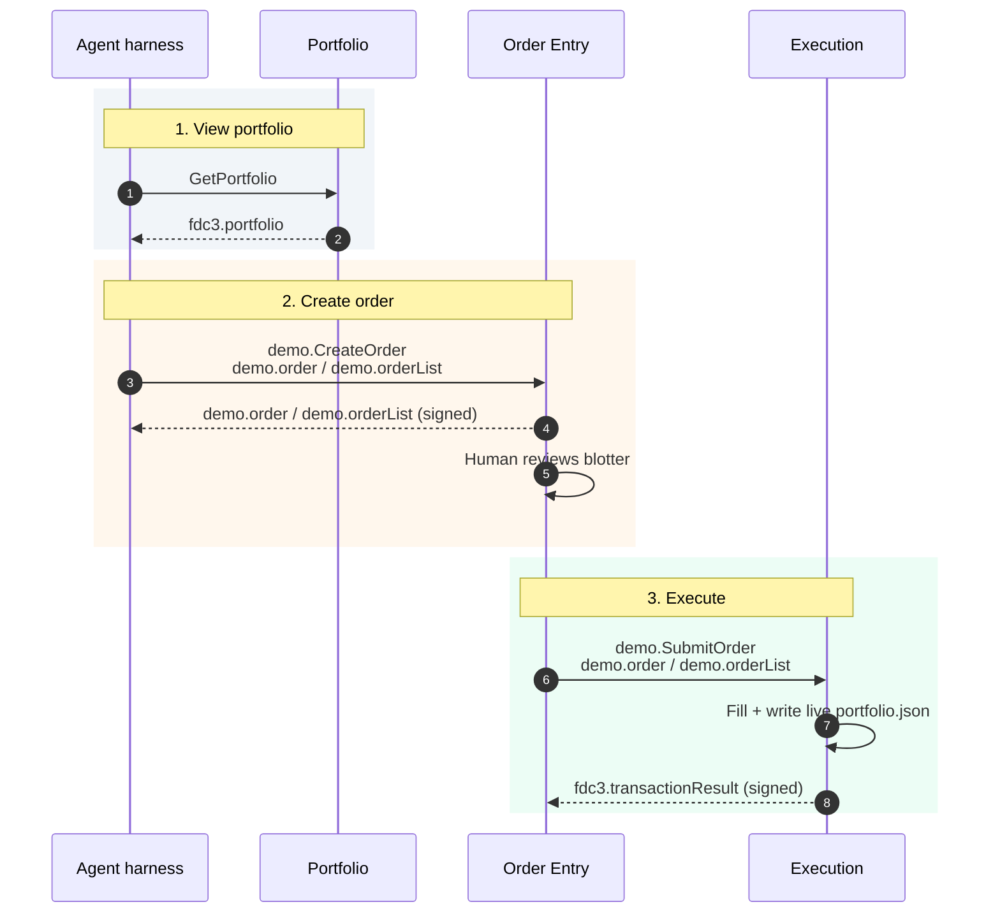

# `demo.*` — AIPA suite context types

Local JSON Schemas for AIPA `demo.*` contexts (not standard FDC3 types). Indexed by
the Discoverability app from this folder so `fdc3_discover_context_schema` can
return field shapes for agents.

## View, create, execute

Intents are raised via the Desktop Agent; the swimlanes are the apps that own
each hop. The harness views the book with `GetPortfolio`. Order Entry signs a
`demo.order` or `demo.orderList` for `demo.CreateOrder`. After human review,
Order Entry raises `demo.SubmitOrder`; Execution fills and writes the live
portfolio file.

| Step | Intent | Context in | Context out |
| --- | --- | --- | --- |
| View portfolio | `GetPortfolio` | — | `fdc3.portfolio` |
| Create order | `demo.CreateOrder` | `demo.order` or `demo.orderList` | same type, signed |
| Execute | `demo.SubmitOrder` (Order Entry) | `demo.order` or `demo.orderList` | `fdc3.transactionResult` (signed) |

`demo.order` is one name. `demo.orderList` is the multi-row / basket form
(mirroring `fdc3.orderList`). Portfolio reloads `temp/portfolio.json` on a
timer, so the holdings UI refreshes after Execution writes fills.

| File | `type` |
| --- | --- |
| [`schemas/order.schema.json`](schemas/order.schema.json) | `demo.order` |
| [`schemas/orderList.schema.json`](schemas/orderList.schema.json) | `demo.orderList` |
| [`schemas/portfolioRisk.schema.json`](schemas/portfolioRisk.schema.json) | `demo.portfolioRisk` |
| [`schemas/researchBundle.schema.json`](schemas/researchBundle.schema.json) | `demo.researchBundle` |
| [`schemas/stressScenarioRequest.schema.json`](schemas/stressScenarioRequest.schema.json) | `demo.stressScenarioRequest` |
| [`schemas/stressScenarioResult.schema.json`](schemas/stressScenarioResult.schema.json) | `demo.stressScenarioResult` |
| [`schemas/priceHistory.schema.json`](schemas/priceHistory.schema.json) | `demo.priceHistory` |
