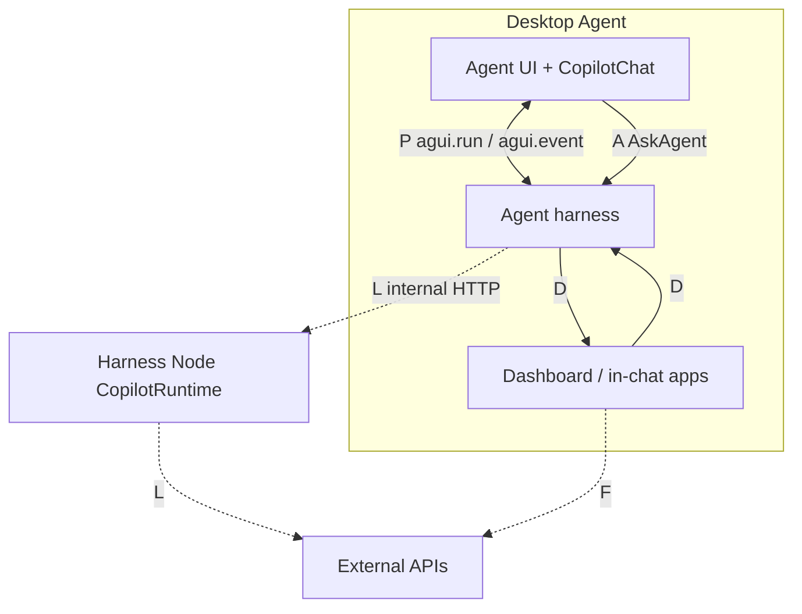
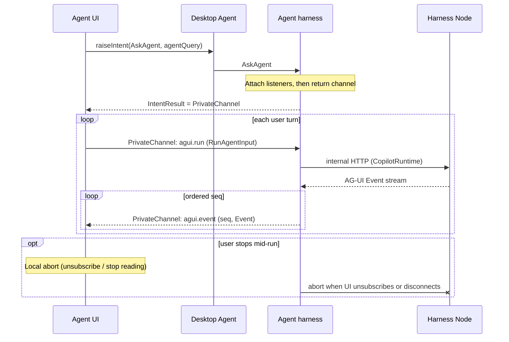

# `fdc3.ai` — agentic apps (AG-UI over FDC3)

Proposed FDC3 extension for agentic apps hosted by a **Desktop Agent**.

**Agent UI** and **Agent harness** are FDC3 apps. Conversation is **AG-UI** carried in thin `fdc3.ai.agui.run` / `agui.event` envelopes on a session **PrivateChannel**. LLM providers sit off the bus as ordinary HTTP (harness browser ↔ Node only). Data apps are covered in [`fdc3.data`](../fdc3.data/). Capability catalogs live in [`fdc3.capability`](../fdc3.capability/).

This is an **AIPA binding**, not an FDC3 or AG-UI standard. AG-UI is the conversation contract; FDC3 is how the pipe is obtained and multiplexed on the desktop.

## Where things live

| Piece | Role |
| --- | --- |
| Desktop Agent | FDC3 platform. Owns App Directory, intent resolution, PrivateChannels. |
| Agent UI | FDC3 app — CopilotKit `CopilotChat` + `Fdc3PrivateChannelAgent` (AG-UI transport). |
| Agent harness | FDC3 app — bridges PrivateChannel ↔ Node runtime; executes desktop tools under harness identity. |
| Harness Node | CopilotRuntime / agent loop; providers; server-side tools. |
| **P** | Session PrivateChannel: `fdc3.ai.agui.run` / `agui.event` only. |
| **A** | `raiseIntent("AskAgent", fdc3.ai.agentQuery)` → IntentResult = PrivateChannel. |

## UI ↔ harness channel

| Context type | From | To | Role |
| --- | --- | --- | --- |
| [`fdc3.ai.agentQuery`](schemas/agentQuery.schema.json) | Agent UI | Agent harness | FDC3 connection setup for `AskAgent`. IntentResult = PrivateChannel. |
| [`fdc3.ai.agui.run`](schemas/agui.run.schema.json) | Agent UI | Agent harness | Envelope over AG-UI `RunAgentInput`. |
| [`fdc3.ai.agui.event`](schemas/agui.event.schema.json) | Agent harness | Agent UI | Envelope over AG-UI `Event` + monotonic `seq`. |

`Fdc3PrivateChannelAgent` is an AG-UI transport only: it dials the channel via `AskAgent`, then sends `RunAgentInput` and reads `Event`s. Stop is local abort (as with cancelling an HTTP/SSE read); the harness stops when the UI unsubscribes or disconnects.

Attachments travel on `RunAgentInput.forwardedProps` (AG-UI). Optional `fdc3.data.file` on the same channel is a separate data concern, not part of the AG-UI transport.

### Correlation / ordering

- `threadId` is chosen by the UI on `agentQuery` / `RunAgentInput` and kept for the PrivateChannel.
- `runId` is unique per user turn; lifecycle events carry it.
- Harness assigns `seq` starting at 1 **per session**. UI applies in order; ignores duplicates.
- Desktop tools are executed by the **harness** (`executeFdc3Tool`), keyed by AG-UI `toolCallId`.

## Schemas

| File | `type` | Notes |
| --- | --- | --- |
| [`schemas/agentQuery.schema.json`](schemas/agentQuery.schema.json) | `fdc3.ai.agentQuery` | FDC3 AskAgent bootstrap |
| [`schemas/agui.run.schema.json`](schemas/agui.run.schema.json) | `fdc3.ai.agui.run` | Envelope over AG-UI `#RunAgentInput` |
| [`schemas/agui.event.schema.json`](schemas/agui.event.schema.json) | `fdc3.ai.agui.event` | Envelope over AG-UI `#Event` |

`agui.run` / `agui.event` only define the FDC3 envelope. Payload shapes `$ref` the published AG-UI 1.0 schema: [`#RunAgentInput`](https://ag-ui.com/spec/1.0/schema.json#RunAgentInput) and [`#Event`](https://ag-ui.com/spec/1.0/schema.json#Event).
