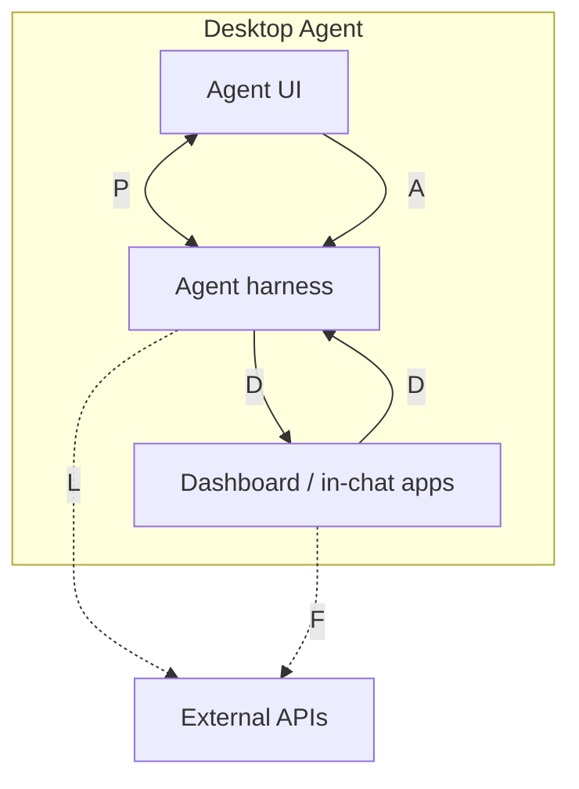

# `fdc3.ai` — agentic apps

Proposed FDC3 extension for agentic apps hosted by a **Desktop Agent**.

**Agent UI** and **Agent harness** are FDC3 apps. They talk over a per-turn **PrivateChannel** using `fdc3.ai.*` contexts. LLM providers sit off the bus as ordinary HTTP. Data apps are covered in [`fdc3.data`](../fdc3.data/).

## Where things live

| Piece | Role |
| --- | --- |
| Desktop Agent | FDC3 platform. Owns App Directory, intent resolution, user channels, PrivateChannels. |
| Agent UI | FDC3 app — transcript, composer, citations; opens in-chat apps. |
| Agent harness | FDC3 app — LLM loop, tool planning; raises intents via the Desktop Agent API. |
| Dashboard / in-chat apps | Data apps — see [`fdc3.data`](../fdc3.data/). |
| **P** | Per-turn PrivateChannel: `fdc3.ai.agentDelta`, `agentAnswer`, `agentCancel`. |
| **A** | `raiseIntent("AskAgent", fdc3.ai.agentQuery)` → IntentResult = PrivateChannel. |
| **D** | Harness ↔ data apps — [`fdc3.data`](../fdc3.data/). |
| **L / F** | Ordinary fetch (not FDC3): harness → LLM; apps → data backends. |

## What talks to what

FDC3 hops for the agentic loop always go via the Desktop Agent. The harness is a full FDC3 app and **raises intents itself** (`fdc3.raiseIntent` / `getResult`). The PrivateChannel between UI and harness carries conversation streaming only.

| Job | From | To | FDC3 mechanism | Purpose |
| --- | --- | --- | --- | --- |
| Start turn | Agent UI | Agent harness | `raiseIntent("AskAgent", fdc3.ai.agentQuery)` → PrivateChannel | Start a turn; shared channel. |
| Stream reply | Agent harness | Agent UI | PrivateChannel `broadcast(fdc3.ai.agentDelta \| fdc3.ai.agentAnswer)` | Stream reply; final answer closes the turn. |
| Cancel | Agent UI | Agent harness | PrivateChannel `fdc3.ai.agentCancel` | Abort the LLM loop. |
| Instrument sync | Any app on channel | Peers | User channel `broadcast(fdc3.instrument)` | Cross-app symbol sync. |

## UI ↔ harness channel contexts

| Context type | From | To | Role |
| --- | --- | --- | --- |
| [`fdc3.ai.agentQuery`](schemas/agentQuery.schema.json) | Agent UI | Agent harness | Initial `AskAgent` payload; optional follow-ups on the channel. |
| [`fdc3.ai.agentDelta`](schemas/agentDelta.schema.json) | Agent harness | Agent UI | Streaming text / status / artifact / citation. |
| [`fdc3.ai.agentAnswer`](schemas/agentAnswer.schema.json) | Agent harness | Agent UI | Final markdown + citations + artifacts + suggestions. |
| [`fdc3.ai.agentCancel`](schemas/agentCancel.schema.json) | Agent UI | Agent harness | Stop the turn. |

Tool / data-app calls do **not** ride this PrivateChannel. The harness raises those intents separately (see [`fdc3.data`](../fdc3.data/)) and awaits `getResult()`.

Agent UI and Agent harness are both FDC3 apps on the Desktop Agent; their conversation is a PrivateChannel under `fdc3.ai.*`.

## Schemas

JSON Schema definitions (draft-07), same composition pattern as [`@finos/fdc3` context schemas](https://github.com/finos/FDC3/tree/main/packages/fdc3-context/schemas/context): each type `allOf`s [`context.schema.json#/definitions/BaseContext`](schemas/context.schema.json).

| File | `type` |
| --- | --- |
| [`schemas/agentQuery.schema.json`](schemas/agentQuery.schema.json) | `fdc3.ai.agentQuery` |
| [`schemas/agentDelta.schema.json`](schemas/agentDelta.schema.json) | `fdc3.ai.agentDelta` |
| [`schemas/agentAnswer.schema.json`](schemas/agentAnswer.schema.json) | `fdc3.ai.agentAnswer` |
| [`schemas/agentCancel.schema.json`](schemas/agentCancel.schema.json) | `fdc3.ai.agentCancel` |
