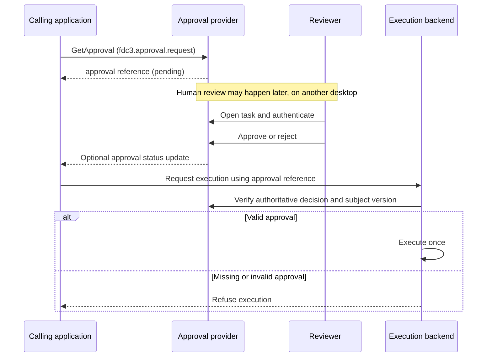

# `fdc3.approval` — human approval workflows

Proposed FDC3 extension for **requesting human approval, viewing its progress and opening a review interface**, independently of the workflow engine that manages the decision.

An application raises `GetApproval` with a description of the proposed action and its subject. An approval provider accepts the request, returns a durable approval reference and manages the human workflow. 

## Flow



The execution backend may instead be called by a provider-side worker. Either arrangement must verify approval before execution. An approved request does not itself mean the action has executed.

## Intents and contexts

| Intent | Input context | Purpose | Result |
| --- | --- | --- | --- |
| `GetApproval` | [`fdc3.approval.request`](schemas/request.schema.json) | Submit a proposed action for human approval. | [`fdc3.approval`](schemas/approval.schema.json), acknowledging acceptance and providing a durable reference. |
| `ViewApproval` | [`fdc3.approval`](schemas/approval.schema.json) | Open an existing approval to inspect its current state and available history. | No result required. |
| `ReviewApproval` | [`fdc3.approval`](schemas/approval.schema.json) | Open the decision interface for an authorised reviewer. | No result required; the decision is recorded through the provider's authenticated service. |

`ReviewApproval` opens a task. It does not grant review permission or record a decision merely because the intent was raised. There is no `ApproveOrder` or generic `Approve` intent in the initial proposal.

The approval app opens to **My tasks** when launched without context. Notifications and the inbox deliver work to reviewers; opening an app on the requester's desktop does not deliver it to another user.

## Approval request

[`fdc3.approval.request`](schemas/request.schema.json) describes what needs approval. Its `subject` is a nested context object so that the same protocol can support orders, payments, data exports and AI-proposed actions.

| Field | Required | Meaning |
| --- | --- | --- |
| `type` | Yes | `fdc3.approval.request`. |
| `id.requestId` | Yes | Caller-generated correlation and retry identifier. Scoped by the provider to the authenticated caller. |
| `name` | No | Short display label. |
| `subject` | Yes | Domain context identifying the proposed action or object and the exact version to be reviewed. |
| `reason` | Yes | Explanation of why approval is being requested. Informational; the provider validates the applicable policy. |
| `expiresAt` | No | Requested expiry as an RFC 3339 timestamp. The provider may enforce a different deadline and returns the effective value. |

```json
{
  "type": "fdc3.approval.request",
  "id": {
    "requestId": "req-123"
  },
  "name": "Approve order above trading limit",
  "subject": {
    "type": "demo.order",
    "id": {
      "orderId": "ORD-123",
      "version": "3"
    }
  },
  "reason": "Order exceeds the GBP 100,000 approval threshold",
  "expiresAt": "2026-11-03T20:00:00Z"
}
```

`demo.order` is an illustrative domain context, not a standard order schema. Each supported subject type must define how to identify and resolve an immutable version or snapshot. The provider fetches authoritative details rather than trusting values supplied in the context.

Repeated requests with the same authenticated caller and `requestId` return the same approval. Reusing that identifier with a different subject or request content is an error. Identical request IDs from different callers must not collide.

## Approval reference and state

[`fdc3.approval`](schemas/approval.schema.json) identifies a provider-managed approval and can carry a snapshot of its state. It is used both as the result of `GetApproval` and as input to the viewing intents.

| Field | Required | Meaning |
| --- | --- | --- |
| `type` | Yes | `fdc3.approval`. |
| `id.approvalId` | Yes | Durable identifier assigned by the provider. |
| `provider` | Yes | Configured service identifier used to resolve the approval, including its environment. Not an arbitrary endpoint to trust. |
| `id.requestId` | No | Original caller correlation identifier. |
| `name` | No | Short display label. |
| `subject` | No | Reference to the reviewed subject and version. |
| `status` | No | State snapshot; omitted in a minimal navigation reference. |
| `updatedAt` | No | Time of the state snapshot. |
| `expiresAt` | No | Effective expiry assigned by the provider. |
| `decisionReason` | No | Explanation accompanying the final outcome, where appropriate to disclose. |

```json
{
  "type": "fdc3.approval",
  "id": {
    "approvalId": "approval-456",
    "requestId": "req-123"
  },
  "provider": "demo-fluxnova",
  "name": "Approval for order ORD-123",
  "subject": {
    "type": "demo.order",
    "id": {
      "orderId": "ORD-123",
      "version": "3"
    }
  },
  "status": "pending",
  "updatedAt": "2026-11-03T19:00:00Z",
  "expiresAt": "2026-11-03T20:00:00Z"
}
```

Provider service identifiers are distinct from FDC3 app IDs: an app handles desktop interaction, while a service owns the durable decision. The deployment maps providers to trusted backends and appropriate viewing applications.

| Status | Meaning |
| --- | --- |
| `pending` | Accepted and awaiting a final decision. |
| `approved` | The provider recorded approval for the specified subject version. |
| `rejected` | The reviewer declined the request. |
| `cancelled` | The request was withdrawn or invalidated. |
| `expired` | The review deadline passed without a final decision. |

The initial lifecycle is `pending` followed by one terminal outcome. Terminal approvals are not reopened; a changed proposal requires a new request. An execution policy can still refuse an approved action if its validity conditions no longer hold.

Failure to accept or retrieve a request is a technical error, not a human rejection. Providers should distinguish invalid input, unsupported subject types, access denial, missing approvals and service unavailability. Exact error payloads remain to be specified.

## Results and updates

`GetApproval` returns an acknowledgement promptly. It must not hold an intent result open while waiting for a human decision.

The initial contract returns one `fdc3.approval` context. Live updates can be added through an explicitly negotiated result-channel profile; that profile must specify channel setup, subscription ordering and recovery before it is treated as interoperable. Status updates would use the same approval context.

The durable approval remains accessible through the provider after a channel closes or a desktop restarts. `ViewApproval` reloads its current state. A backend status API is needed for automated callers that must resume monitoring without opening a UI; standardising that API is outside this desktop extension's initial scope.

Approval details must not be broadcast on shared user channels or a shared app-channel bus. Clients treat received snapshots as display information and resolve current state through an authenticated provider connection.

## Policy and enforcement

The extension standardises interaction with an approval provider. It does not make desktop messages an authorisation mechanism.

| Responsibility | Owner |
| --- | --- |
| Decide whether approval is required | Trusted domain backend / policy service. |
| Resolve the subject and freeze its reviewed version | Domain backend and approval provider. |
| Select eligible reviewers and prevent self-approval | Approval provider using authenticated identity and policy. |
| Record the decision, reviewer, timestamps and policy version | Approval provider. |
| Verify the decision before execution | Execution backend. |
| Prevent duplicate execution | Execution backend. |

The requester cannot choose an authoritative reviewer identity, waive separation of duties or declare an approval valid by including fields in a context. The provider derives requester and reviewer identities from authenticated sessions. A shared browser session pretending to be two users would only simulate this control.

Changes to quantity, price, instrument or other material subject fields require reassessment. Approval is bound to the reviewed version or snapshot. The backend verifies that binding, the current validity conditions and its own policy before acting. It refuses execution when approval cannot be verified.

Cancellation, expiry and reviewer completion must be resolved consistently by the provider so that competing actions cannot produce contradictory final outcomes.

## Fluxnova implementation

Proposed adapter responsibilities:

| Piece | Role |
| --- | --- |
| Fluxnova FDC3 app | Handles the three intents; displays My tasks, approval progress and review forms. |
| Approval service | Authenticates users, resolves subjects, applies policy, deduplicates requests and maps public approval IDs to Fluxnova instances/tasks. |
| Fluxnova process | Runs the human task, approval/rejection branch and expiry handling. |
| Domain backend / worker | Validates the recorded decision and submits the approved action once. |

Fluxnova process-instance IDs and task IDs stay behind the adapter. The calling application depends on approval concepts rather than BPMN implementation details.

For the order demo:

1. A trader or AI prepares an order. The order backend calculates its authoritative value.
2. An order at or below the configured threshold proceeds under the normal submission policy.
3. An order above the threshold enters `pendingApproval`; the backend creates or validates the approval request. FDC3 provides the app-facing request and navigation interface, while backend enforcement applies to every entry point.
4. The trader opens `ViewApproval` to inspect progress.
5. A second authenticated user opens the task from their inbox or through `ReviewApproval` and approves or rejects it.
6. Approval permits the backend worker to submit the reviewed order version. Rejection or expiry prevents submission.
7. The demo shows the decision history alongside the resulting order state.

The AI can propose an action and request approval. Its own approval claim has no authority over execution.

## Discoverability

Declare the intents and supported contexts in the approval app's App Directory record. Following the attached `fdc3.discoverability` proposal, include a `purpose` string so an agent can understand when to use each intent. `purpose` is an extension property in that proposal, not a standard App Directory field.

```json
{
  "appId": "demo-fluxnova-approval",
  "interop": {
    "intents": {
      "listensFor": {
        "GetApproval": {
          "displayName": "Get Approval",
          "purpose": "Get independent human approval for a proposed action.",
          "contexts": ["fdc3.approval.request"],
          "resultType": "fdc3.approval"
        },
        "ViewApproval": {
          "displayName": "View Approval",
          "purpose": "Inspect an existing approval's current state and history.",
          "contexts": ["fdc3.approval"]
        },
        "ReviewApproval": {
          "displayName": "Review Approval",
          "purpose": "Open an approval for an authorised human reviewer to decide.",
          "contexts": ["fdc3.approval"]
        }
      }
    }
  }
}
```

This is an interoperability fragment, not a complete launchable App Directory record.

## Schemas

JSON Schema definitions (draft-07), same composition pattern as [`@finos/fdc3` context schemas](https://github.com/finos/FDC3/tree/main/packages/fdc3-context/schemas/context): each type `allOf`s [`context.schema.json#/definitions/BaseContext`](schemas/context.schema.json). Register these schemas with the discoverability responder so callers can look up the exact context shape before constructing requests.

| File | `type` |
| --- | --- |
| [`schemas/request.schema.json`](schemas/request.schema.json) | `fdc3.approval.request` |
| [`schemas/approval.schema.json`](schemas/approval.schema.json) | `fdc3.approval` |

## Initial scope and open decisions

Start with **one request, one immutable subject and one final outcome**. Multiple reviewers, quorum, delegation and escalation can be managed internally by a provider without exposing their task structures through FDC3.

Before implementation, agree:

- Namespace ownership and naming of the extension.
- The domain subject schema and version-resolution contract.
- Provider registration, trusted service resolution and identity integration.
- Technical error representation and whether to add a live-update channel profile.
- How backend clients request and query approvals alongside desktop callers.

Cancellation intents, machine-readable reviewer rules and portable audit evidence are later extensions. The initial interoperability test is whether the order application can use a second approval provider without changing its request, reference or navigation contexts.
