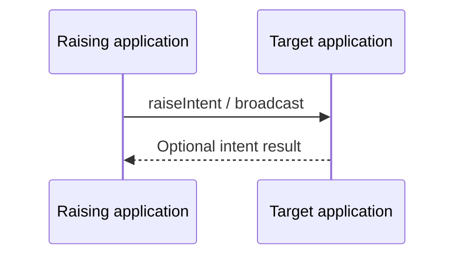
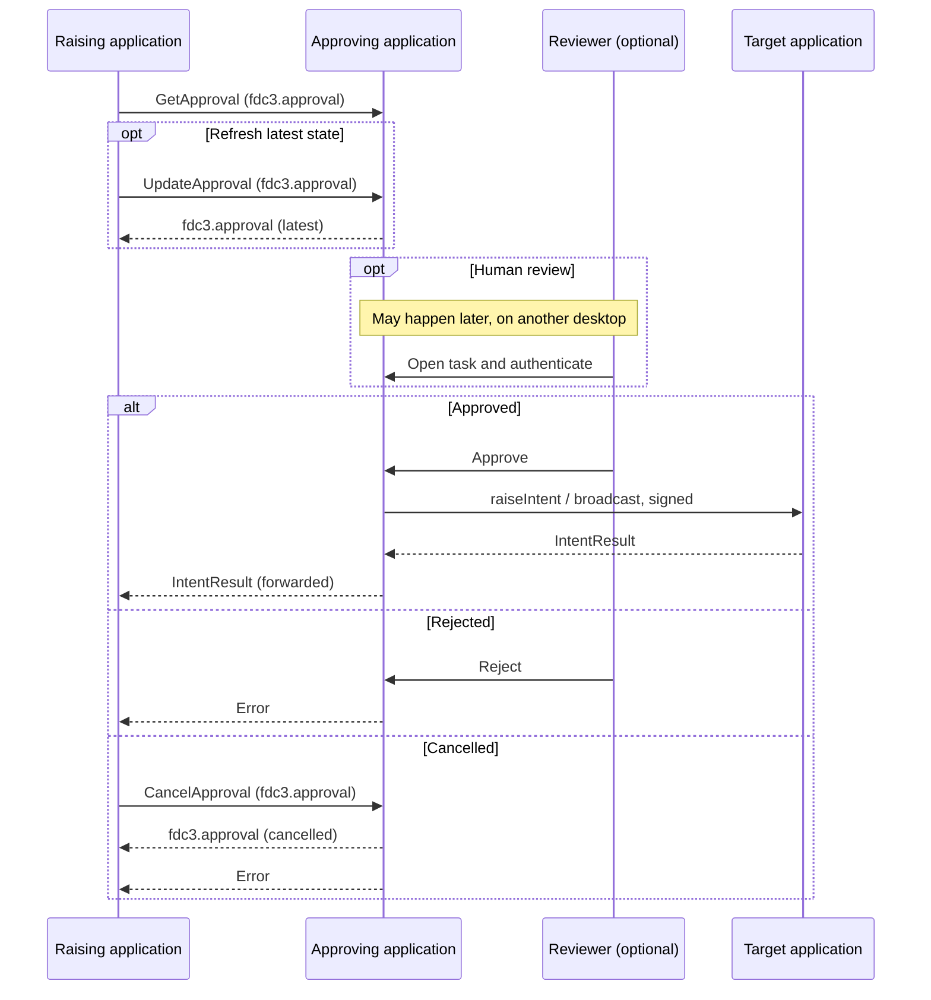

# `fdc3.approval` — human approval workflows

Proposed FDC3 extension for **requesting human approval, viewing its progress and opening a review interface**, independently of the workflow engine that manages the decision.

The **raising application** wants an [`fdc3.action`](https://fdc3.finos.org/docs/next/context/ref/Action) performed at a **target application**. When no approval is required, it raises that action itself and receives the target's IntentResult. When approval is required, it raises `GetApproval` to the **approving application**, which later performs the same action — signed as itself — at the target, then forwards the target's IntentResult back to the raising application. A **reviewer** may take part in that decision; some providers can record approval without a separate review UI.

## Flow

### Without approvals

The raising application raises the intent (or broadcasts) directly at the target application.



### With approvals

The raising application raises `GetApproval` with an `fdc3.approval` whose `subject` is the `fdc3.action`. After approval, the approving application raises that same action at the target application, then forwards the target's IntentResult to the raising application as the result of `GetApproval`.



The approving application executes the approved action once. The target treats the signed raise or broadcast as coming from the approving application, not the raising application. `GetApproval` stays open until that workflow finishes. On approval, the raising application receives the target's IntentResult, forwarded unchanged — the same result it would have received by raising that action itself. If the target returns no result (typical for `broadcast`), `GetApproval` completes without a context. A rejected, cancelled or expired request is not executed and completes `GetApproval` with an error. Execution failure after approval is a technical error; it does not reopen or reverse the decision.

## Intents and contexts


| Intent           | Input context                                    | Purpose                                                                                                                                       | Result                                                                                                                                                                    |
| ---------------- | ------------------------------------------------ | --------------------------------------------------------------------------------------------------------------------------------------------- | ------------------------------------------------------------------------------------------------------------------------------------------------------------------------- |
| `GetApproval`    | [`fdc3.approval`](schemas/approval.schema.json)  | Submit a proposed `fdc3.action` (in `subject`) for human approval. If approved, the approving application executes it and forwards the target's IntentResult. | The target's IntentResult, forwarded by the approving application. The type is that of the subject action (for example `fdc3.transactionResult` after `demo.SubmitOrder`). |
| `UpdateApproval` | [`fdc3.approval`](schemas/approval.schema.json)  | Send the raising application's current `fdc3.approval` and receive the approving application's latest snapshot. Does not change the decision. | [`fdc3.approval`](schemas/approval.schema.json) with current `status` and identifiers.                                                                                     |
| `CancelApproval` | [`fdc3.approval`](schemas/approval.schema.json)  | Withdraw a `pending` approval. Resolves by `id.requestId` and/or `id.approvalId`. Only the authenticated caller (or the approving application invalidating the request) may cancel. | [`fdc3.approval`](schemas/approval.schema.json) with `status` `cancelled`. An outstanding `GetApproval` completes with an error.                                          |
| `ViewApproval`   | [`fdc3.approval`](schemas/approval.schema.json)  | Open an existing approval to inspect its current state and available history.                                                                | No result required.                                                                                                                                                       |
| `ReviewApproval` | [`fdc3.approval`](schemas/approval.schema.json)  | Open the decision interface for an authorised reviewer.                                                                                      | No result required; the decision is recorded through the provider's authenticated service.                                                                                |


`UpdateApproval` is how the raising application refreshes its copy without opening a UI: it sends the `fdc3.approval` it holds, resolved by `id.requestId` and/or `id.approvalId`, and receives the latest snapshot. Input fields other than those identifiers are locators and display hints, not a patch: the raising application cannot change `subject`, `status` or the recorded decision this way. The durable approval remains accessible this way after `GetApproval` has completed.

`CancelApproval` is the facility that produces `cancelled`. It succeeds only while `status` is `pending`. A terminal approval (`approved`, `rejected`, `cancelled`, `expired`) cannot be cancelled; that raise is an error. Optional `decisionReason` on the input is a withdrawal note; the result snapshot records the effective reason.

`ViewApproval` opens that snapshot in the approving application's UI. `ReviewApproval` opens a task. It does not grant review permission or record a decision merely because the intent was raised. There is no `ApproveOrder` or generic `Approve` intent in the initial proposal.

The approval app opens to **My tasks** when launched without context. Notifications and the inbox deliver work to reviewers; opening an app on the requester's desktop does not deliver it to another user.

### fdc3.approval

[`fdc3.approval`](schemas/approval.schema.json) is the single context type for this extension. It is the input to `GetApproval`, `UpdateApproval`, `CancelApproval`, `ViewApproval` and `ReviewApproval`, and the IntentResult of `UpdateApproval` and `CancelApproval`. `subject` is an [`fdc3.action`](https://fdc3.finos.org/docs/next/context/ref/Action): raise an intent or broadcast a context. The nested `subject.context` is the domain object of that action (an order, payment, data export or AI-proposed payload). `status` is the only distinction between a newly raised request and a later snapshot.

It is not the IntentResult of `GetApproval`; that result is the target's result, forwarded at the end of the workflow. Approval details must not be broadcast on shared user channels or a shared app-channel bus. Clients treat received snapshots as display information and resolve current state through an authenticated provider connection.


| Field            | Required | Meaning                                                                                                      |
| ---------------- | -------- | ------------------------------------------------------------------------------------------------------------ |
| `type`           | Yes      | `fdc3.approval`.                                                                                             |
| `id.requestId`   | One of   | Caller-generated correlation and retry identifier. Required when raising `GetApproval`.                      |
| `id.approvalId`  | One of   | Durable identifier assigned by the approving application after it accepts the request.                       |
| `name`           | No       | Short display label.                                                                                         |
| `subject`        | Yes      | The `fdc3.action` to perform if approved.                                                                    |
| `reason`         | No       | Why approval is being requested. Informational; the approving application validates the applicable policy.   |
| `status`         | No       | Lifecycle state. Omit or send `pending` when raising `GetApproval`.                                          |
| `updatedAt`      | No       | Time of the state snapshot.                                                                                  |
| `expiresAt`      | No       | Review deadline. Present only while `status` is `pending`.                                                   |
| `decisionReason` | No       | Explanation accompanying the final outcome, where appropriate to disclose.                                   |


```json
{
  "type": "fdc3.approval",
  "id": {
    "requestId": "req-123"
  },
  "name": "Approve order above trading limit",
  "subject": {
    "type": "fdc3.action",
    "action": "raiseIntent",
    "title": "Submit order ORD-123",
    "intent": "demo.SubmitOrder",
    "context": {
      "type": "demo.order",
      "id": {
        "orderId": "ORD-123",
        "version": "3"
      }
    }
  },
  "reason": "Order exceeds the GBP 100,000 approval threshold",
  "status": "pending",
  "expiresAt": "2026-11-03T20:00:00Z"
}
```

`demo.order` is an illustrative nested context, not a standard order schema. Each supported nested type must define how to identify and resolve an immutable version or snapshot. The approving application fetches authoritative details rather than trusting values supplied in `subject.context`.

Repeated `GetApproval` raises with the same authenticated caller and `requestId` return the same approval. Reusing that identifier with a different subject or request content is an error. Identical request IDs from different callers must not collide.


| Status      | Meaning                                                                                              |
| ----------- | ---------------------------------------------------------------------------------------------------- |
| `pending`   | Accepted and awaiting a final decision.                                                              |
| `approved`  | The provider recorded approval for the specified action and will execute it, signed as the provider. |
| `rejected`  | The reviewer declined the request.                                                                   |
| `cancelled` | Withdrawn through `CancelApproval`, or invalidated by the approving application.                     |
| `expired`   | The review deadline passed without a final decision.                                                 |


The initial lifecycle is `pending` followed by one terminal outcome. Terminal approvals are not reopened; a changed proposal requires a new request. An execution policy can still refuse an approved action if its validity conditions no longer hold.

`UpdateApproval` returns a snapshot in one of these states. After `approved`:

```json
{
  "type": "fdc3.approval",
  "id": {
    "approvalId": "approval-456",
    "requestId": "req-123"
  },
  "name": "Approval for order ORD-123",
  "subject": {
    "type": "fdc3.action",
    "action": "raiseIntent",
    "title": "Submit order ORD-123",
    "intent": "demo.SubmitOrder",
    "context": {
      "type": "demo.order",
      "id": {
        "orderId": "ORD-123",
        "version": "3"
      }
    }
  },
  "reason": "Order exceeds the GBP 100,000 approval threshold",
  "status": "approved",
  "updatedAt": "2026-11-03T19:12:00Z",
  "decisionReason": "Within desk mandate after limit-exception review"
}
```

After `cancelled` (`CancelApproval` while still `pending`):

```json
{
  "type": "fdc3.approval",
  "id": {
    "approvalId": "approval-456",
    "requestId": "req-123"
  },
  "name": "Approval for order ORD-123",
  "subject": {
    "type": "fdc3.action",
    "action": "raiseIntent",
    "title": "Submit order ORD-123",
    "intent": "demo.SubmitOrder",
    "context": {
      "type": "demo.order",
      "id": {
        "orderId": "ORD-123",
        "version": "3"
      }
    }
  },
  "reason": "Order exceeds the GBP 100,000 approval threshold",
  "status": "cancelled",
  "updatedAt": "2026-11-03T19:08:00Z",
  "decisionReason": "Requester withdrew the order"
}
```

After `rejected`:

```json
{
  "type": "fdc3.approval",
  "id": {
    "approvalId": "approval-456",
    "requestId": "req-123"
  },
  "name": "Approval for order ORD-123",
  "subject": {
    "type": "fdc3.action",
    "action": "raiseIntent",
    "title": "Submit order ORD-123",
    "intent": "demo.SubmitOrder",
    "context": {
      "type": "demo.order",
      "id": {
        "orderId": "ORD-123",
        "version": "3"
      }
    }
  },
  "reason": "Order exceeds the GBP 100,000 approval threshold",
  "status": "rejected",
  "updatedAt": "2026-11-03T19:12:00Z",
  "decisionReason": "Position would breach the NVDA single-name limit"
}
```

Failure to accept or retrieve a request is a technical error, not a human rejection. Providers should distinguish invalid input, unsupported actions or nested context types, access denial, missing approvals and service unavailability. Exact error payloads remain to be specified.

How approval interacts with a Sail governance extension is in [`sail-governance.md`](sail-governance.md).
The AIPA mapping onto Fluxnova is in [`fluxnova.md`](fluxnova.md). 