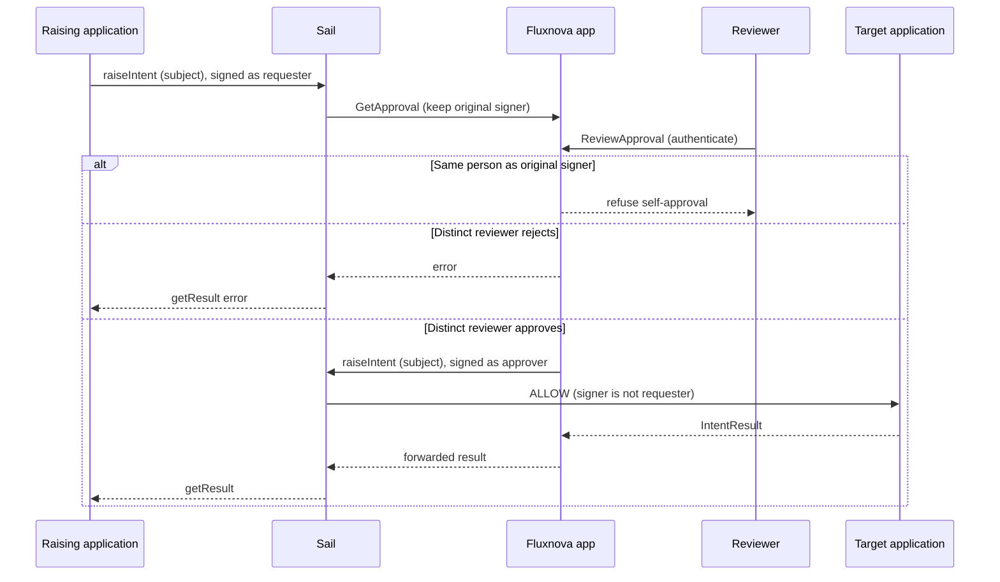
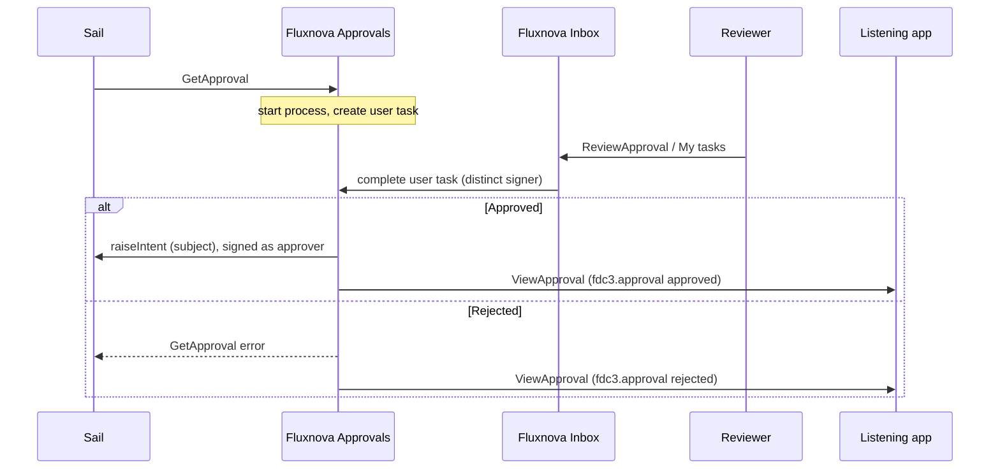

# Fluxnova implementation

How the AIPA demo maps [`fdc3.approval`](README.md) onto Fluxnova in Sail. Fluxnova is a Camunda-shaped engine: BPMN processes, user tasks, and a Tasklist. Sail decides *whether* approval is required ([`sail-governance.md`](sail-governance.md)). Fluxnova’s job is **four-eyes where needed**: a second authenticated human, who is not the requester, must complete the user task.

Signed messages are what make that rule checkable. The original raise carries the requester’s (or assistant’s) signature. Fluxnova will not complete the user task as that same identity. After a distinct reviewer approves, the Fluxnova app raises the subject action signed as the approving application. Sail `ALLOW`s that second raise because the signer is no longer the original actor. The target sees only that signed raise.



The AI can propose the original action. Its signature has no authority over execution, and it cannot complete the Fluxnova user task.

## Current demo slice

See [`server-apps/fluxnova`](../../server-apps/fluxnova/README.md): two apps on port **4112**.

- **AIPA Fluxnova** (`aipa-fluxnova`) — invisible singleton inbox (Sail Governance opens it when posting `GetApproval`). Listens for `CreateTask` and `GetApproval`. Polls the engine worklist. Does **not** open a view on `GetApproval` (the approver may be another desktop). When a **new** open task appears on a later poll, it raises `ViewTask` at `aipa-fluxnova-view`. When a held task becomes `approved` in the engine, this inbox performs the subject `fdc3.action` (signed raise or broadcast) and forwards the result.
- **AIPA Fluxnova Task** (`aipa-fluxnova-view`) — visible singleton panel. Listens for `ViewTask`, renders the task, and Approve/Deny complete the Fluxnova user task via the REST API.

Sail Governance’s config **GetApproval app** selects the target: `aipa-approvals` (stub inbox), `aipa-fluxnova` (this path), or `none` (any connected listener). The [Approvals stub](../../server-apps/approvals/README.md) (port 4110) remains the default. Native Tasklist (`http://localhost:8080/fluxnova/app/tasklist/`, demo/demo) still works as a fallback.

## Sail apps

Two FDC3 apps sit on the Fluxnova engine. They are the Camunda Tasklist and the approval-intent bridge, not a new workflow product.

| App | Sail host | Role |
| --- | --- | --- |
| Fluxnova Inbox (`aipa-fluxnova`) | Invisible, singleton. Popup is the worklist. | Polls Fluxnova. Starts a process on `GetApproval`. Opens `ViewTask` when a **new** task arrives on poll (not on the raise — the approver may be another user). When the engine records approval, performs the subject action or fails `GetApproval`. |
| Fluxnova Task (`aipa-fluxnova-view`) | Visible, singleton, not autostart. | The task panel. Approve/Deny complete the user task through the Fluxnova API. Does not execute the subject action. |

The inbox is how people action Fluxnova work in Sail. Opening an inbox on the requester’s desktop does not deliver the task to another user; notifications and the inbox on the reviewer’s desktop do.

## Starting a workflow

`GetApproval` is the start message. Sail (or any explicit caller) raises it at Fluxnova Approvals with `fdc3.approval`. That app starts the four-eyes process, stores the original signer, and creates the user task.

The process instance is an FDC3 identifier, not a hidden adapter secret. After accept, snapshots include it on `id`:

```json
{
  "type": "fdc3.approval",
  "id": {
    "requestId": "req-123",
    "approvalId": "approval-456",
    "processInstanceId": "a1b2c3-fluxnova-instance"
  }
}
```

`UpdateApproval`, `CancelApproval`, `ViewApproval` and `ReviewApproval` may resolve by `requestId`, `approvalId` or `processInstanceId`. BPMN definition keys, activity ids and variables stay off the wire.

| Intent | App | Meaning in Fluxnova |
| --- | --- | --- |
| `GetApproval` | Approvals | Start (or idempotently resume) the approval process. |
| `UpdateApproval` | Approvals | Latest process snapshot. Does not complete the task. |
| `CancelApproval` | Approvals | Cancel a `pending` process. |
| `ViewApproval` | Inbox | Open that case read-only. |
| `ReviewApproval` | Inbox | Open the user task for the signed-in reviewer. Does not complete the task by itself. |

The current apps use `ViewTask` (`demo.task`) to open `aipa-fluxnova-view` as a Sail panel. That is the demo stand-in for `ReviewApproval`: the view records the decision on the engine; the inbox still performs the subject action.

## Completing a workflow

When the user task is completed, Fluxnova Approvals tells the rest of the desktop in two FDC3 ways. It does not dump BPMN internals onto a shared user channel.

1. **The held raise.** `GetApproval` stays open. On approve, Fluxnova Approvals raises the subject action signed as itself and forwards the target’s IntentResult to Sail, which completes the original `getResult()`. On reject, cancel or expiry it completes `GetApproval` with an error. That is how the raising application learns the outcome without knowing about Fluxnova.
2. **A snapshot to listeners.** Fluxnova Inbox or Fluxnova Approvals raises `ViewApproval` with the terminal `fdc3.approval` at apps that handle it — for example a blotter or governance trace — or sends that snapshot on a **private / app channel** those apps joined. `status` is the news (`approved`, `rejected`, `cancelled`, `expired`). Clients treat it as display information and resolve current state through `UpdateApproval`. Approval details are not broadcast on shared user channels.


