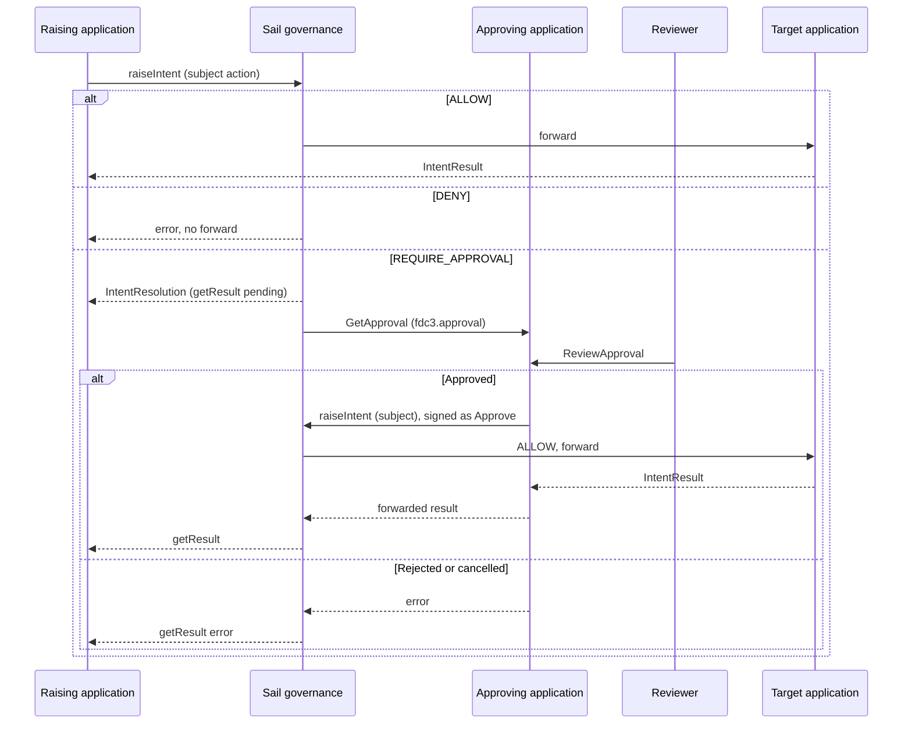

# Sail governance and `fdc3.approval`

How the [`fdc3.approval`](README.md) protocol interacts with a Sail Desktop Agent governance extension. The raising application and the target application do not know about approvals. They raise and handle the subject intent the same way in a governed or ungoverned desktop. Sail is a man-in-the-middle on the Desktop Agent. The approving application remains the human-approval provider.

The extension will live under [`FDC3-Sail/extensions`](https://github.com/finos/FDC3-Sail/tree/main/extensions), using the [`@finos/sail-extension`](https://github.com/finos/FDC3-Sail/tree/main/packages/sail-extension) contract (`id`, `title`, `wrapServer`, optional `sail.config` UI). It is not implemented in this folder.

## Roles

| Piece | Role |
| --- | --- |
| Raising application | Raises the subject action (`raiseIntent` or broadcast). Does not raise `GetApproval`. |
| Sail governance extension | Wraps `FDC3ServerInstance` via `wrapServer` and inspects DACP `receive` traffic. Evaluates actor, intent and context against versioned policy. Raises the `GetApproval` intent when required. Completes the original raise with the forwarded result or an error. Does not record a human decision. |
| Approving application | Records the human decision and, if approved, performs the subject action signed as itself. Fluxnova or any other engine stays behind this adapter — see [`fluxnova.md`](fluxnova.md). |
| Reviewer | Opens the task through `ReviewApproval` (or the provider inbox) and authenticates. The AI cannot record that decision. |
| Target application | Handles the subject action when Sail forwards it. Does not need to know whether an approval occurred. |

## Governance Decision Outcomes

Whenever sail-governance is asked to do an evaluation, it could decide in one of the following ways:

| Outcome | Effect |
| --- | --- |
| `ALLOW` | Forward the original workflow. Both apps see the ungoverned path. |
| `DENY` | Do not forward. Workflow results in an error. The raising/broadcasting app learns delivery failed, not that an approval protocol exists. |
| `REQUIRE_APPROVAL` | Do not forward the original action. `raiseIntent` creates an intent result while it raises a `GetApproval` intent. Park `getResult()` until the approval workflow finishes. |

`raiseIntent` is not specified to time out because a handler is slow. The long wait belongs on `getResult()`, which has no mandated duration. Holding the DACP `raiseIntentRequest` unanswered until a human decides would look like a hung Desktop Agent on a web proxy (`appLaunchTimeout`).

Copy the original app and user identity onto the approval. Four-eyes and “requester is not the reviewer” apply to that actor, not to Sail.

`GetApproval` and the approver’s second raise must not be escalated again.

After `approved`, the approving application performs the subject action signed as itself. Sail treats that as a different actor and `ALLOW`s it. An assistant-originated execute remains `DENY` (`apa-ctl-006`).

`GetApproval`, `UpdateApproval`, `CancelApproval`, `ViewApproval` and `ReviewApproval` are handled by the approval app. Users may raise them to inspect or act on a request. That does not circumvent Sail: the subject action is forwarded only after a completed approval.

## Evidence

Sail does not keep Gemara receipts in extension storage or files. After each
decision it raises intents defined by [`fdc3.gemara`](../fdc3.gemara/README.md)
to the **Governance Console** application:

| Intent | Context | Receipt |
| --- | --- | --- |
| `LogEvaluation` | `fdc3.gemara.evaluationLog` | Layer 5 — inspection of the original raise: activity, original actor, policy/control versions, and `ALLOW` / `DENY` / `REQUIRE_APPROVAL` ([Evaluation Log](https://gemara.openssf.org/schema/)). |
| `LogEnforcement` | `fdc3.gemara.enforcementLog` | Layer 6 — what Sail then did: forward, deny, or hold and raise `GetApproval` ([Enforcement Log](https://gemara.openssf.org/schema/)). |

The Console owns append-only display of those documents and persists them in
`temp/evaluation-log.json` / `temp/enforcement-log.json`. `LogEvaluation` /
`LogEnforcement` are passthrough for Sail (not re-evaluated).
