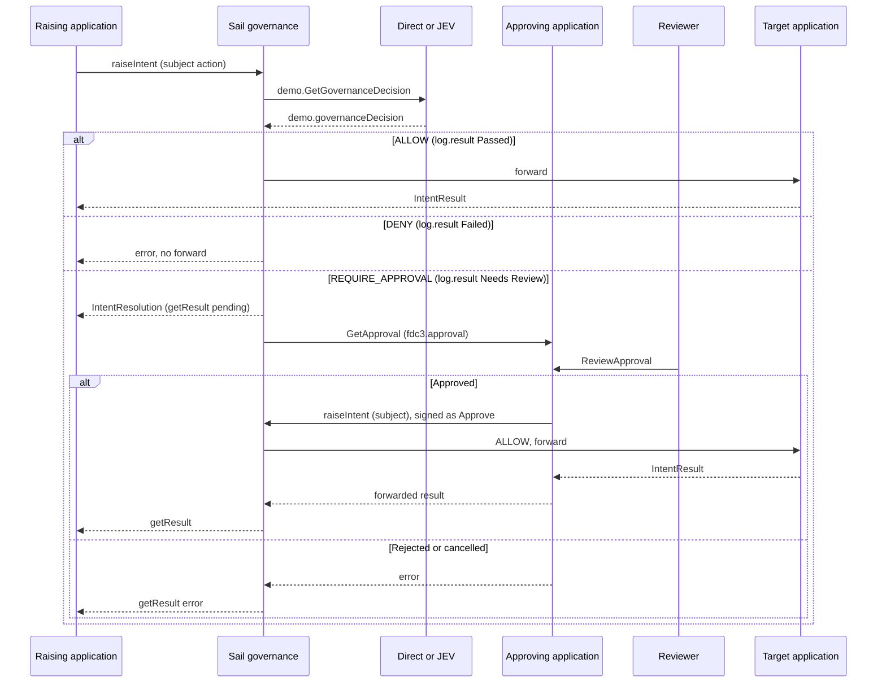

# Sail governance and `fdc3.approval`

How the [`fdc3.approval`](README.md) protocol interacts with a Sail Desktop Agent governance extension. The raising application and the target application do not know about approvals. They raise and handle the subject intent the same way in a governed or ungoverned desktop. Sail is a man-in-the-middle on the Desktop Agent. The approving application remains the human-approval provider.

The extension will live under [`FDC3-Sail/extensions`](https://github.com/finos/FDC3-Sail/tree/main/extensions), using the [`@finos/sail-extension`](https://github.com/finos/FDC3-Sail/tree/main/packages/sail-extension) contract (`id`, `title`, `wrapServer`, optional `sail.config` UI). It is not implemented in this folder.

## Roles

| Piece | Role |
| --- | --- |
| Raising application | Raises the subject action (`raiseIntent` or broadcast). Does not raise `GetApproval`. |
| Sail governance extension | **Policy enforcement point (PEP).** Wraps `FDC3ServerInstance` via `wrapServer` and inspects DACP `receive` traffic. Asks a policy decision point for `demo.GetGovernanceDecision`, then enforces `log.result`. Raises `GetApproval` when the PDP escalates. Completes the original raise with the forwarded result or an error. Does not record a human decision and does not raise `LogEvaluation` or `LogEnforcement`. |
| Direct / JEV app | **Policy decision point (PDP).** Fills the Gemara EvaluationLog on `demo.governanceDecision` and raises `LogEvaluation`. Raises `LogEnforcement` when the result is Allow or Deny. Direct applies the unsigned-vs-trusted SubmitOrder rule; JEV scores committed Jev rules. |
| Approving application | Records the human decision and, if approved, performs the subject action signed as itself. Raises `LogEnforcement` when it holds `GetApproval` and when it executes an approved action. Fluxnova or any other engine stays behind this adapter — see [`fluxnova.md`](fluxnova.md). |
| Reviewer | Opens the task through `ReviewApproval` (or the provider inbox) and authenticates. The AI cannot record that decision. |
| Target application | Handles the subject action when Sail forwards it. Does not need to know whether an approval occurred. |

## Governance Decision Outcomes

Sail maps the PDP’s `log.result` (`Passed` / `Needs Review` / `Failed`) onto:

| Outcome | Effect |
| --- | --- |
| `ALLOW` | Forward the original workflow. Both apps see the ungoverned path. |
| `DENY` | Do not forward. Workflow results in an error. The raising/broadcasting app learns delivery failed, not that an approval protocol exists. |
| `REQUIRE_APPROVAL` | Do not forward the original action. `raiseIntent` creates an intent result while it raises a `GetApproval` intent. Park `getResult()` until the approval workflow finishes. |

`raiseIntent` is not specified to time out because a handler is slow. The long wait belongs on `getResult()`, which has no mandated duration. Holding the DACP `raiseIntentRequest` unanswered until a human decides would look like a hung Desktop Agent on a web proxy (`appLaunchTimeout`).

Copy the original app and user identity onto the approval. Four-eyes and “requester is not the reviewer” apply to that actor, not to Sail.

`GetApproval` and the approver’s second raise must not be escalated again.

After `approved`, the approving application performs the subject action signed as itself. Sail asks the PDP again; Direct / JEV Allow a trusted-approver raise. An assistant-originated execute remains a control failure (`apa-ctl-006`).

`GetApproval`, `UpdateApproval`, `CancelApproval`, `ViewApproval` and `ReviewApproval` are handled by the approval app. Users may raise them to inspect or act on a request. That does not circumvent Sail: the subject action is forwarded only after a completed approval.

## Evidence

Sail does not keep Gemara receipts in extension storage or files, and it does
not raise `LogEvaluation` or `LogEnforcement`. Decision apps (Direct / JEV)
raise `LogEvaluation` always and `LogEnforcement` on Allow / Deny. Approval
apps raise `LogEnforcement` on hold (`GetApproval`) and on approved execute.
Both use [`fdc3.gemara`](../fdc3.gemara/README.md) to the **Governance Console**
application:

| Intent | Context | Receipt |
| --- | --- | --- |
| `LogEvaluation` | `fdc3.gemara.evaluationLog` | Layer 5 — raised by the PDP: inspection of the original raise, policy/control versions, and `Passed` / `Needs Review` / `Failed` ([Evaluation Log](https://gemara.openssf.org/schema/)). |
| `LogEnforcement` | `fdc3.gemara.enforcementLog` | Layer 6 — raised by the PDP on Allow / Deny, and by the approval app on hold and approved execute ([Enforcement Log](https://gemara.openssf.org/schema/)). |

The Console owns append-only display of those documents and persists them in
`temp/evaluation-log.json` / `temp/enforcement-log.json`. `LogEvaluation` /
`LogEnforcement` are passthrough for Sail (not re-evaluated).
