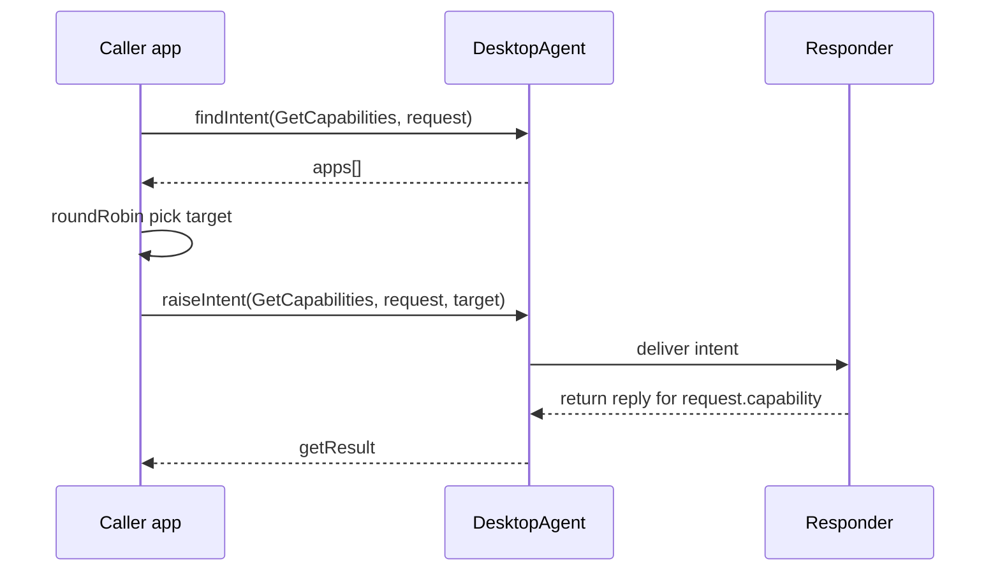

# `fdc3.capability` — catalog capabilities

Proposed FDC3 extension for **catalog-style discovery** of apps, intents, context types, **JSON Schemas for a given context type**, and **full App Directory records for a given appId** on a Desktop Agent.

An app raises the standard-shaped intent **`GetCapabilities`** with a single context type [`fdc3.capability.request`](schemas/request.schema.json). The required `capability` enum selects which catalog slice to return as the IntentResult. Typical responder is an agent harness peer or another platform app that knows the App Directory / capability set.

This is separate from:

- Session conversation under [`fdc3.ai`](../fdc3.ai/) (PrivateChannel streaming)
- Dataset advertising under [`fdc3.data`](../fdc3.data/) (user-channel offers)
- Runtime resolution via Desktop Agent `findIntent` / `findIntentsByContext` (also exposed as `fdc3_*` tools)

## Flow



## `capability` enum → IntentResult

| `capability` | Required extras | IntentResult |
| --- | --- | --- |
| `apps` | — | [`fdc3.capability.appDirectory`](schemas/appDirectory.schema.json) — slim app entries (`appId`, `title`, `description`) |
| `intents` | — | [`fdc3.capability.intentList`](schemas/intentList.schema.json) — intent names + `purpose` (+ optional metadata) |
| `contextTypes` | — | [`fdc3.capability.contextTypeList`](schemas/contextTypeList.schema.json) — `contextType` + optional `name` / `description` / schema URL |
| `contextSchema` | `contextType` | [`fdc3.capability.contextSchema`](schemas/contextSchema.schema.json) — JSON Schema for one `contextType` |
| `appDirectoryRecord` | `appId` | [`fdc3.capability.appDirectoryRecord`](schemas/appDirectoryRecord.schema.json) — full FDC3 `Application` for one `appId` |

| Concept | Role |
| --- | --- |
| Intent `GetCapabilities` | Retrieve a catalog slice; IntentResult is the matching reply context. |
| `fdc3.capability.request` | Raised context. `capability` enum selects the slice; optional `contextType` / `appId` for parametric queries. |
| `appDirectory` | Slim app catalog (`appId`, optional `title` / `description`). |
| `intentList` | Intent catalog entries (`name`, required `purpose`, optional display/contexts/resultType). |
| `contextTypeList` | Context type catalog entries (`contextType`, optional `name` / `description` / `schemaUrl`). |
| `contextSchema` | Schema document (`schema` + optional `schemaUrl`), or `error` when unknown. |
| `appDirectoryRecord` | Embeds the FDC3 `Application` object in `record`, or `error` when unknown. |

App Directory records declare `listensFor.GetCapabilities` with `contexts: ["fdc3.capability.request"]` and **omit `resultType`** — AppD allows only one `resultType` string, while replies are polymorphic. Callers discriminate by the request’s `capability` value.

## Context schema lookup

When `capability` is `contextSchema`, the request must include `contextType` (exact FDC3 `type` string). The reply echoes that type and, when found, includes:

| Field | Meaning |
| --- | --- |
| `contextType` | Echo of the request. |
| `schema` | The JSON Schema object (draft-07) for that context. |
| `schemaUrl` | Canonical `$id` / published URI when known. |
| `error` | Present when no schema is registered; `schema` is omitted. |

Request / reply example:

```json
{
  "type": "fdc3.capability.request",
  "capability": "contextSchema",
  "contextType": "fdc3.data.markdown"
}
```

```json
{
  "type": "fdc3.capability.contextSchema",
  "contextType": "fdc3.data.markdown",
  "schemaUrl": "https://fdc3.finos.org/schemas/next/context/data.markdown.schema.json",
  "schema": { "$schema": "http://json-schema.org/draft-07/schema#", "type": "object" }
}
```

In AIPA, the capability responder resolves schemas in this order:

1. Local [`fdc3-extensions/*/schemas`](../) (including suite [`demo.*` types](../demo/))
2. Published standard context JSON Schemas from [`@finos/fdc3-context`](https://www.npmjs.com/package/@finos/fdc3-context) (`dist/schemas/context`) — `title`, `description`, and `$id` populate `name` / `description` / `schemaUrl` on `contextTypeList`
3. FDC3 CDN `https://fdc3.finos.org/schemas/next/context/<type-without-fdc3-prefix>.schema.json` for other `fdc3.*` types

Unknown types return `error`. (`@finos/fdc3-schema` is the DACP/API package and is not used for context-type catalogs.)

Agents should use this when building a context payload (after discovering the type name), not as a substitute for `capability: "contextTypes"`.

## App Directory record lookup

When `capability` is `appDirectoryRecord`, the request must include `appId`. The reply echoes that id and, when found, embeds the record:

| Field | Meaning |
| --- | --- |
| `appId` | Echo of the request. |
| `record` | The App Directory `Application` object (`appId`, `title`, `type`, `details`, optional `interop`, `hostManifests`, icons, …). |
| `error` | Present when no record is registered; `record` is omitted. |

`record` is imported from the FDC3 App Directory specification — [`Application`](https://fdc3.finos.org/schemas/next/appd.schema.json#/components/schemas/Application) — not redefined here. That is the same object App Directory `GET /v2/apps/{appId}` returns.

This is distinct from [`fdc3.capability.appDirectory`](schemas/appDirectory.schema.json), which is a **slim catalog** (`appId` / `title` / `description`) for planning. Use the slim list first (`capability: "apps"`), then fetch one record when you need launch details, declared intents, or host manifests.

Request / reply example:

```json
{
  "type": "fdc3.capability.request",
  "capability": "appDirectoryRecord",
  "appId": "aipa-capability"
}
```

```json
{
  "type": "fdc3.capability.appDirectoryRecord",
  "appId": "aipa-capability",
  "record": {
    "appId": "aipa-capability",
    "title": "AIPA Capability",
    "type": "web",
    "details": { "url": "http://localhost:4109/" }
  }
}
```

Unknown `appId` returns `error`.

## Intent `purpose` (App Directory extension)

`fdc3.capability.intentList` requires a **`purpose`** string on every intent entry: a short explanation of *when / why* a caller should raise that intent. Agents and planners use it to choose among catalog intents without inventing names or guessing semantics from `displayName` alone.

`purpose` is **not** part of the standard FDC3 App Directory `Application` schema. AIPA carries it as an extra property on each intent under `interop.intents.listensFor` in the app’s AppD record. The capability responder copies it into the IntentResult; intents without a non-empty `purpose` are omitted from the catalog.

```json
{
  "appId": "aipa-market-data",
  "interop": {
    "intents": {
      "listensFor": {
        "ViewChart": {
          "displayName": "View Chart",
          "purpose": "Open a price chart for an instrument in the market-data UI.",
          "contexts": ["fdc3.instrument"]
        }
      }
    }
  }
}
```

Reply shape (see [`intentList.schema.json`](schemas/intentList.schema.json)):

```json
{
  "type": "fdc3.capability.intentList",
  "intents": [
    {
      "name": "ViewChart",
      "purpose": "Open a price chart for an instrument in the market-data UI.",
      "displayName": "View Chart",
      "contexts": ["fdc3.instrument"]
    }
  ]
}
```

When the same intent name is declared by multiple apps, the catalog merges `contexts` and keeps a single `purpose` (joining distinct purpose strings with ` | ` if they differ).

## Multi-app resolution

When several apps listen for `GetCapabilities`, callers SHOULD:

1. `findIntent('GetCapabilities', request)`
2. Pick the next app with a per-intent round-robin cursor
3. `raiseIntent('GetCapabilities', request, { appId })` and await `getResult()`

Do not rely on the Desktop Agent resolver UI for catalog queries.

## How this relates to other discovery

| Mechanism | Discovers | Channel / API |
| --- | --- | --- |
| `fdc3.capability` (this package) | Apps / intents / context types / context schemas / full AppD records for planning | Intent `GetCapabilities` + `fdc3.capability.request` |
| [`fdc3.data` advertiseDatasets](../fdc3.data/) | Shareable **datasets** (not apps) | User channel |
| Desktop Agent `findIntent` / `findIntentsByContext` | Runtime handlers for a specific intent or context | Direct API |

Discovery here is catalog-oriented (what exists / what can I call / what shape does a context have). `findIntent` for *other* intents remains the right tool when you already know an intent or context and need a live resolution.

## AIPA implementation

| Piece | Role |
| --- | --- |
| [`server-apps/capability`](../../server-apps/capability/) | Responder app (port **4109**, `aipa-capability`). Listens for `GetCapabilities` and replies from the combined App Directory (`GET /api/catalog`), schema lookup (`GET /api/context-schema?contextType=`), and full record lookup (`GET /api/app-directory-record?appId=`). |
| Agent harness tools | `fdc3_discover_apps` / `fdc3_discover_intents` / `fdc3_discover_context_types` / `fdc3_discover_context_schema` / `fdc3_discover_app_directory_record` — browser-executed `findIntent` + round-robin + `raiseIntent` / `getResult` for `GetCapabilities`. |

## Schemas

JSON Schema definitions (draft-07), same composition pattern as [`@finos/fdc3` context schemas](https://github.com/finos/FDC3/tree/main/packages/fdc3-context/schemas/context): each type `allOf`s [`context.schema.json#/definitions/BaseContext`](schemas/context.schema.json).

| File | `type` |
| --- | --- |
| [`schemas/request.schema.json`](schemas/request.schema.json) | `fdc3.capability.request` |
| [`schemas/appDirectory.schema.json`](schemas/appDirectory.schema.json) | `fdc3.capability.appDirectory` |
| [`schemas/intentList.schema.json`](schemas/intentList.schema.json) | `fdc3.capability.intentList` |
| [`schemas/contextTypeList.schema.json`](schemas/contextTypeList.schema.json) | `fdc3.capability.contextTypeList` |
| [`schemas/contextSchema.schema.json`](schemas/contextSchema.schema.json) | `fdc3.capability.contextSchema` |
| [`schemas/appDirectoryRecord.schema.json`](schemas/appDirectoryRecord.schema.json) | `fdc3.capability.appDirectoryRecord` |
