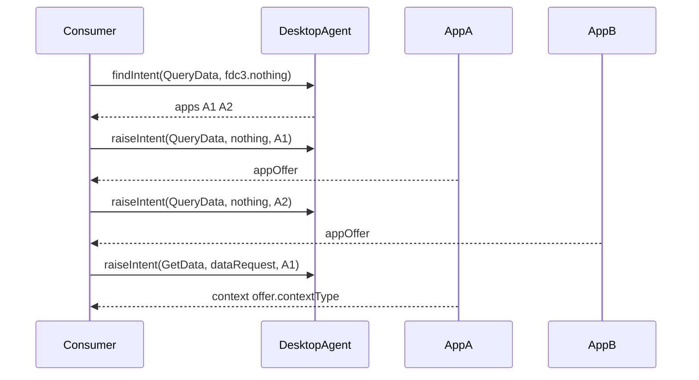
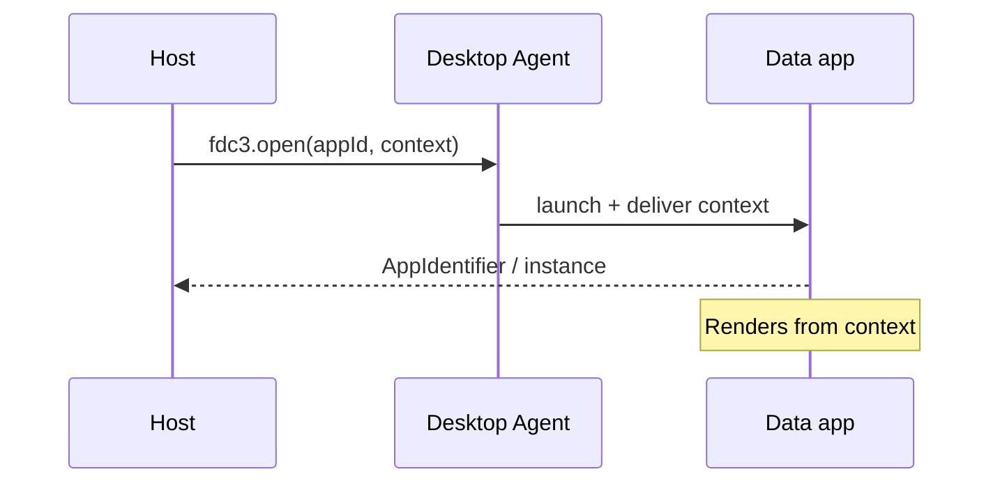
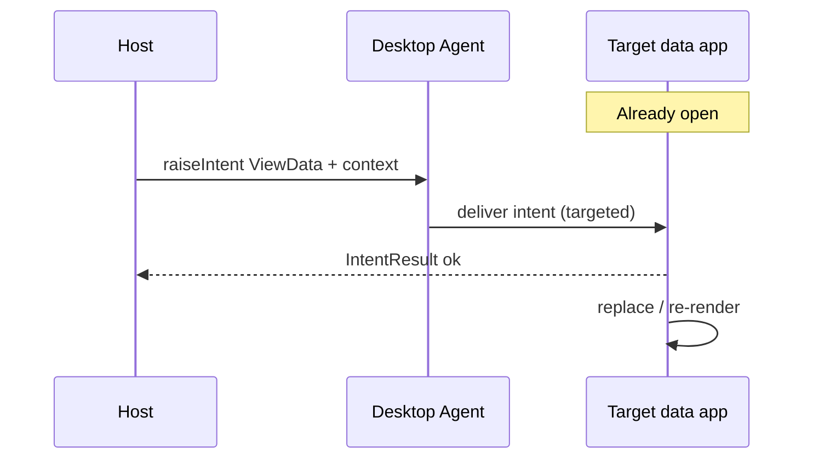
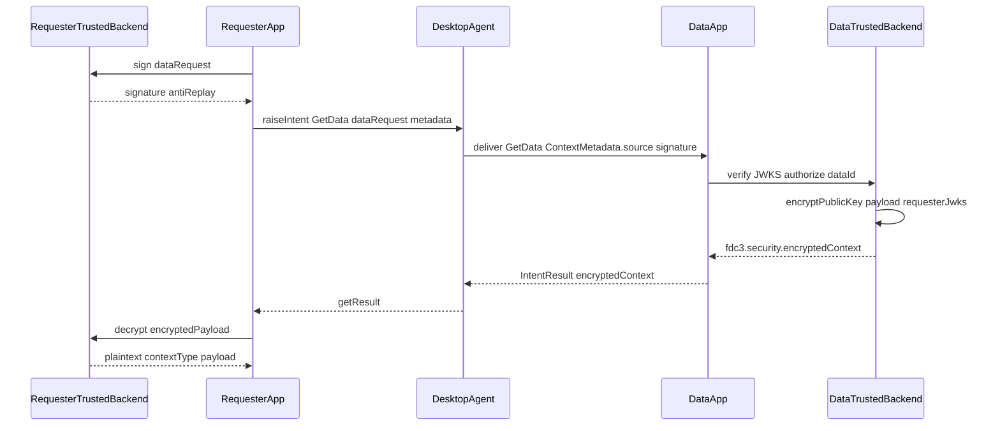

# `fdc3.data` — data apps

Proposed FDC3 extension for **data apps**: FDC3 apps that can advertise shareable datasets, hand context payloads to callers, open with seeded context, and accept a replacement later. Offered and returned types are whatever the app advertises (`contextType`) — e.g. `fdc3.data.tabularData`, `fdc3.instrument`, `fdc3.chart`, or an org-specific type — not only tables.

Contexts and intents for that contract live under `fdc3.data.*` (plus unprefixed intents `QueryData` / `GetData` / `ViewData`).

A data app may sit on a dashboard tile or inside a chat bubble; the wire contract is the same. The host platform is the **Desktop Agent**.

## What a data app does

A minimal data app implements four behaviours:

1. **Advertise** — handle `QueryData` and return an IntentResult `fdc3.data.appOffer` (metadata for each shareable dataset, not the full payload).
2. **Serve** — handle `GetData` and return an IntentResult whose type matches the offer’s `contextType`.
3. **Open with data** — accept `fdc3.open(appId, context)` (existing FDC3 functionality) for context types it supports.
4. **Replace data** — handle `ViewData` with context and re-render in place. The app should advertise in its AppD record which context types it accepts for `ViewData`.

## Discovering shareable datasets (`QueryData`)

A consumer resolves data apps with `findIntent('QueryData', { type: 'fdc3.nothing' })`, then raises `QueryData` at **each** target (fan-out) and collects `fdc3.data.appOffer` IntentResults. The consumer then raises a targeted `GetData` for a chosen offer. Discovery is about **bits of data**, not App Directory catalogs — for those see [`fdc3.capability`](../fdc3.capability/).



| Concept | Role |
| --- | --- |
| `QueryData` | Unprefixed intent. Raised with `fdc3.nothing`. IntentResult is one `fdc3.data.appOffer`. |
| `findIntent('QueryData', …)` | Lists apps that can advertise datasets. Raise at every target to collect offers. |
| `fdc3.data.appOffer` | Metadata-only offer (see shape below) — *not* the full payload. |
| `fdc3.data.dataRequest` | Consumer → targeted app. Intent context for `GetData`: only `id.dataId` (echoed from the offer). |
| `GetData` | Targeted `raiseIntent` → single IntentResult matching that offer’s `contextType`. |
| Share UX | An app opts in by listening for `QueryData`. Unshared datasets stay silent. |

App Directory records declare `listensFor.QueryData` with `contexts: ["fdc3.nothing"]` and `resultType: "fdc3.data.appOffer"`.

### Context shapes

| Context type | From | To | Shape / role |
| --- | --- | --- | --- |
| [`fdc3.data.appOffer`](schemas/appOffer.schema.json) | Data app | Consumer | IntentResult of `QueryData`: `id.dataId`, `source` (`appId` + `instanceId`), `contextType`, `schemaUrl`, `displayMetadata`, optional Dublin Core `metadata`. |
| [`fdc3.data.dataRequest`](schemas/dataRequest.schema.json) | Consumer | Data app | `{ type, id: { dataId } }` — one dataset per raise (IntentResult is a single context). Instance targeting is the `raiseIntent` target, not fields on this context. |
| [`fdc3.data.tabularData`](schemas/tabularData.schema.json) | Data app / host | Consumer / data app | Optional helper type: `columns` + `rows`, optional embedded `fdc3.chart`. Used when an offer’s `contextType` is tabular — not required for every `GetData` / `ViewData`. |
| [`fdc3.data.markdown`](schemas/markdown.schema.json) | Host / agent | Markdown viewer / data app | Helper type: `markdown` body + optional `title`. Used with `fdc3.open` / `ViewData` (distinct from chat `fdc3.ai.agentAnswer.markdown`). |
| [`fdc3.data.file`](schemas/file.schema.json) | Agent UI / host | Harness / data apps | File bytes (`content_b64` or `url`) identified by `id.fileId`; referenced from `fdc3.ai.agentQuery.fileIds`. |

Example offer → request pairing:

```json
// appOffer (IntentResult of QueryData)
{
  "type": "fdc3.data.appOffer",
  "id": { "dataId": "offer-closes-1" },
  "source": { "appId": "example.prices", "instanceId": "inst-1" },
  "contextType": "fdc3.data.tabularData",
  "schemaUrl": "https://fdc3.finos.org/schemas/next/context/data.tabularData.schema.json",
  "displayMetadata": { "name": "Closing prices" }
}

// dataRequest (raiseIntent GetData, targeted at source)
{
  "type": "fdc3.data.dataRequest",
  "id": { "dataId": "offer-closes-1" }
}
```

## Opening a data app with `fdc3.open`

Discovery and `GetData` pull a context *out* of an already-running app (typed by the offer’s `contextType`). To *show* that same (or another) payload — on the dashboard or in chat — open (or raise an intent at) the data app and pass an FDC3 **context** argument the app accepts.



- `fdc3.open` — standard Desktop Agent API; second argument is any Context the app supports (per AppD).
- Alternative: `raiseIntent("ViewData", context, { appId? })` when the user should resolve which instance shows the data.

On launch the data app should join the user channel as needed, then read the open context and render. If no seed context is present, it falls back to fetching from its own backend.

## Replacing data in an open app

Once a data app is live, hosts push a new payload with a **targeted** `ViewData` intent (context type advertised in AppD).



User-channel `broadcast` of the payload is **not** part of this contract — other shared apps would also receive it. Separately, `fdc3.instrument` on the user channel may cause the app to *refetch* from its backend (param-driven reload, not a pushed replace).

## Information security

`QueryData` / `GetData` ride the Desktop Agent like any other intent. Metadata-only `appOffer` replies are usually low sensitivity; the **payload** returned by `GetData` may not be. Data apps SHOULD treat the requesting app’s **FDC3 identity** as the authorization subject, and MUST encrypt sensitive IntentResults so only that requester can read them.

This aligns with FDC3 Security & Identity ([`@finos/fdc3-security`](https://www.npmjs.com/package/@finos/fdc3-security), trusted-backend signing / encryption) and the patterns in the FDC3 [security demo apps](https://github.com/finos/FDC3/tree/main/toolbox/fdc3-example-apps/server-apps) (`GetUser` → `fdc3.security.encryptedContext`, encrypted channel POC).

### Requester identity

When raising `QueryData` or `GetData`, the consumer SHOULD attach FDC3 Security metadata so the data app can authenticate the caller:

1. Sign the raised context (`fdc3.nothing` or `fdc3.data.dataRequest`) on a **trusted backend** (private key never in the browser).
2. Pass the detached JWS + anti-replay on `ContextMetadata` (`signature`, `antiReplay`) with the raise — the same shape AIPA uses for signed intent results.
3. The Desktop Agent delivers `ContextMetadata.source` (`appId` / `instanceId`) to the handler together with that signature.
4. The data app verifies the signature against the requester’s JWKS (`jku` / `kid` on the JWS), checks anti-replay, and authorizes the `dataId` (and any org policy) for that `appId`.

Unsigned raises MAY be accepted for non-sensitive catalog or public datasets; apps that serve regulated or client-confidential data SHOULD refuse unsigned or untrusted requesters.

`appOffer.source` still identifies the **offering** instance for the follow-on `GetData` target. It does not replace requester authentication on the pull.

### Sensitive payloads — encrypt the IntentResult

When the dataset is sensitive, `GetData` MUST NOT return the plaintext offer `contextType` on the wire. Instead return [`fdc3.security.encryptedContext`](https://fdc3.finos.org/docs/context/ref/security/EncryptedContextWrapper): encrypt the real payload to the **requesting app’s public key** (from its JWKS), preserving the original type for routing inside `encryptedContext` (same approach as `GetUser` in the FDC3 IDP demos).



| Step | Who | What |
| --- | --- | --- |
| Sign raise | Requester trusted backend | Detached JWS over `dataRequest`; `jku` points at requester JWKS |
| Authorize | Data app / its backend | Verify signature + anti-replay; map `source.appId` → allowed `dataId`s |
| Encrypt | Data trusted backend | `encryptPublicKey(payload, requesterJwksUrl)` → `fdc3.security.encryptedContext` (`originalType` = offer `contextType`) |
| Decrypt | Requester trusted backend | Unwrap with requester private key; only then hand plaintext to UI / agent tools |

`QueryData` / `appOffer` stay cleartext metadata (what exists, `schemaUrl`, display name). Sensitivity policy belongs on the **GetData** hop. If an offer is confidential even to advertise, the app SHOULD omit it from `QueryData` for unauthorized callers (return no offer or fail the intent) rather than encrypting the offer itself.

For streaming or multi-message sensitive feeds, prefer IntentResult = **PrivateChannel** with encrypted broadcasts (FDC3 encrypted-channel / security POC 2 pattern) instead of a single `GetData` context. That is an alternate result shape for the same authorization story; `fdc3.data`’s default `GetData` contract remains one IntentResult context (plaintext or `encryptedContext`).

## Contract summary

`QueryData` → `appOffer` discovers datasets (findIntent + fan-out raises); `dataRequest` + targeted `GetData` extracts one context of the advertised `contextType` (or `fdc3.security.encryptedContext` when sensitive); `fdc3.open` / `ViewData` seed or replace with whatever context types the app declares it accepts. Requesters SHOULD sign raises; data apps SHOULD encrypt sensitive IntentResults to the requester’s public key.

## Schemas

JSON Schema definitions (draft-07), same composition pattern as [`@finos/fdc3` context schemas](https://github.com/finos/FDC3/tree/main/packages/fdc3-context/schemas/context): each type `allOf`s [`context.schema.json#/definitions/BaseContext`](schemas/context.schema.json).

| File | `type` | Notes |
| --- | --- | --- |
| [`schemas/appOffer.schema.json`](schemas/appOffer.schema.json) | `fdc3.data.appOffer` | IntentResult of `QueryData`; requires `id.dataId`, `source`, `contextType`, `schemaUrl`, `displayMetadata` |
| [`schemas/dataRequest.schema.json`](schemas/dataRequest.schema.json) | `fdc3.data.dataRequest` | Context for `GetData`; requires `id.dataId` only |
| [`schemas/tabularData.schema.json`](schemas/tabularData.schema.json) | `fdc3.data.tabularData` | Helper payload: `columns` / `rows`, optional `chart` (`fdc3.chart`) |
| [`schemas/markdown.schema.json`](schemas/markdown.schema.json) | `fdc3.data.markdown` | Helper payload: `markdown` + optional `title` / `instanceId` |
| [`schemas/file.schema.json`](schemas/file.schema.json) | `fdc3.data.file` | Helper payload: `id.fileId`, filename, format, `content_b64` \| `url` |
