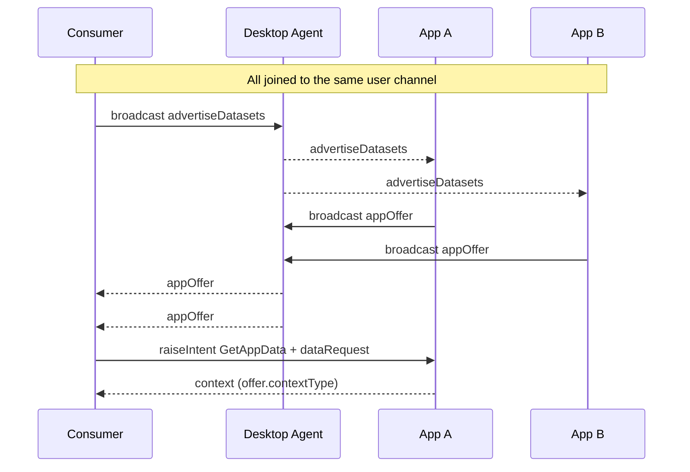
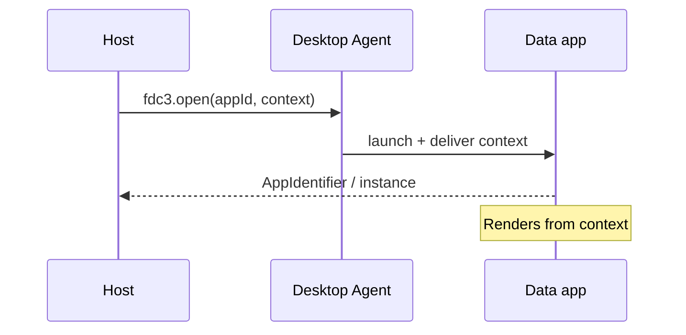
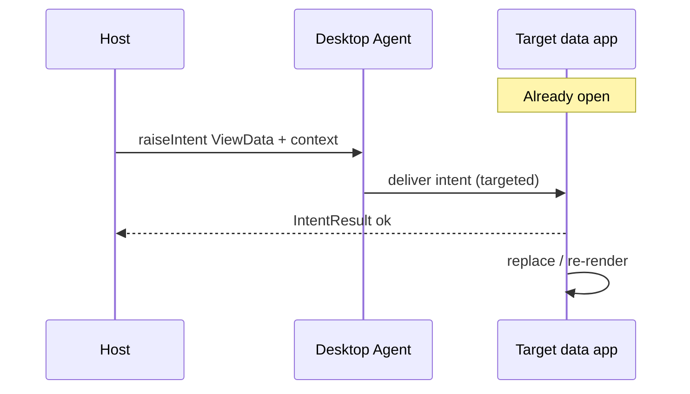

# `fdc3.data` — data apps

Proposed FDC3 extension for **data apps**: FDC3 apps that can advertise shareable datasets, hand context payloads to callers, open with seeded context, and accept a replacement later. Offered and returned types are whatever the app advertises (`contextType`) — e.g. `fdc3.data.tabularData`, `fdc3.instrument`, `fdc3.chart`, or an org-specific type — not only tables.

Contexts and intents for that contract live under `fdc3.data.*`.

A data app may sit on a dashboard tile or inside a chat bubble; the wire contract is the same. The host platform is the **Desktop Agent**.

## What a data app does

A minimal data app implements four behaviours:

1. **Advertise** — answer a user-channel discovery broadcast with metadata for each shareable dataset (not the full payload).
2. **Serve** — handle `GetAppData` and return an IntentResult whose type matches the offer’s `contextType`.
3. **Open with data** — accept `fdc3.open(appId, context)` (existing FDC3 functionality) for context types it supports.
4. **Replace data** — handle `ViewData` with context and re-render in place. The app should advertise in its AppD record which context types it accepts for `ViewData`.

## Discovering shareable datasets (user channel)

A consumer broadcasts `fdc3.data.advertiseDatasets` on the **user channel**. Joined apps that have shareable datasets each reply with one or more `fdc3.data.appOffer` messages (metadata only). The consumer then raises a targeted `GetAppData` for a chosen offer. Discovery is about **bits of data**, not apps. For App Directory / intent / context-type catalogs, see [`fdc3.discoverability`](../fdc3.discoverability/).



| Concept | Role |
| --- | --- |
| User channel | Same Desktop Agent channel used for `fdc3.instrument` sync. Consumer and data apps must be joined before discovery. |
| `fdc3.data.advertiseDatasets` | Consumer → channel. Filterless “what datasets can I use?” |
| `fdc3.data.appOffer` | App → channel. One advertised dataset (see shape below) — *not* the full payload. |
| `fdc3.data.dataRequest` | Consumer → targeted app. Intent context for `GetAppData`: only `id.dataId` (echoed from the offer). |
| `GetAppData` | Targeted `raiseIntent` (Desktop Agent routes to the offering instance) → single IntentResult matching that offer’s `contextType`. |
| Share UX | An app opts in to answer `advertiseDatasets` (or joins the channel only when shared). Unshared datasets stay silent. |

### Context shapes

| Context type | From | To | Shape / role |
| --- | --- | --- | --- |
| [`fdc3.data.advertiseDatasets`](schemas/advertiseDatasets.schema.json) | Consumer | User channel | `{ type }` only — ask apps to advertise shareable datasets. |
| [`fdc3.data.appOffer`](schemas/appOffer.schema.json) | Data app | User channel | `id.dataId`, `source` (`appId` + `instanceId`), `contextType`, `schemaUrl`, `displayMetadata`, optional Dublin Core `metadata`. |
| [`fdc3.data.dataRequest`](schemas/dataRequest.schema.json) | Consumer | Data app | `{ type, id: { dataId } }` — one dataset per raise (IntentResult is a single context). Instance targeting is the `raiseIntent` target, not fields on this context. |
| [`fdc3.data.tabularData`](schemas/tabularData.schema.json) | Data app / host | Consumer / data app | Optional helper type: `columns` + `rows`, optional embedded `fdc3.chart`. Used when an offer’s `contextType` is tabular — not required for every `GetAppData` / `ViewData`. |
| [`fdc3.data.markdown`](schemas/markdown.schema.json) | Host / agent | Markdown viewer / data app | Helper type: `markdown` body + optional `title`. Used with `fdc3.open` / `ViewData` (distinct from chat `fdc3.ai.agentAnswer.markdown`). |
| [`fdc3.data.file`](schemas/file.schema.json) | Agent UI / host | Harness / data apps | File bytes (`content_b64` or `url`) identified by `id.fileId`; referenced from `fdc3.ai.agentQuery.fileIds`. |

Example offer → request pairing:

```json
// appOffer (broadcast)
{
  "type": "fdc3.data.appOffer",
  "id": { "dataId": "offer-closes-1" },
  "source": { "appId": "example.prices", "instanceId": "inst-1" },
  "contextType": "fdc3.data.tabularData",
  "schemaUrl": "https://fdc3.finos.org/schemas/next/context/data.tabularData.schema.json",
  "displayMetadata": { "name": "Closing prices" }
}

// dataRequest (raiseIntent GetAppData, targeted at source)
{
  "type": "fdc3.data.dataRequest",
  "id": { "dataId": "offer-closes-1" }
}
```

## Opening a data app with `fdc3.open`

Discovery and `GetAppData` pull a context *out* of an already-running app (typed by the offer’s `contextType`). To *show* that same (or another) payload — on the dashboard or in chat — open (or raise an intent at) the data app and pass an FDC3 **context** argument the app accepts.



- `fdc3.open` — standard Desktop Agent API; second argument is any Context the app supports (per AppD).
- Alternative: `raiseIntent("ViewData", context, { appId? })` when the user should resolve which instance shows the data.

On launch the data app should join the user channel as needed, then read the open context and render. If no seed context is present, it falls back to fetching from its own backend.

## Replacing data in an open app

Once a data app is live, hosts push a new payload with a **targeted** `ViewData` intent (context type advertised in AppD).



User-channel `broadcast` of the payload is **not** part of this contract — other shared apps would also receive it. Separately, `fdc3.instrument` on the user channel may cause the app to *refetch* from its backend (param-driven reload, not a pushed replace).

## Contract summary

`advertiseDatasets` / `appOffer` discover datasets; `dataRequest` + targeted `GetAppData` extracts one context of the advertised `contextType`; `fdc3.open` / `ViewData` seed or replace with whatever context types the app declares it accepts.

## Schemas

JSON Schema definitions (draft-07), same composition pattern as [`@finos/fdc3` context schemas](https://github.com/finos/FDC3/tree/main/packages/fdc3-context/schemas/context): each type `allOf`s [`context.schema.json#/definitions/BaseContext`](schemas/context.schema.json).

| File | `type` | Notes |
| --- | --- | --- |
| [`schemas/advertiseDatasets.schema.json`](schemas/advertiseDatasets.schema.json) | `fdc3.data.advertiseDatasets` | No filter fields |
| [`schemas/appOffer.schema.json`](schemas/appOffer.schema.json) | `fdc3.data.appOffer` | Requires `id.dataId`, `source`, `contextType`, `schemaUrl`, `displayMetadata` |
| [`schemas/dataRequest.schema.json`](schemas/dataRequest.schema.json) | `fdc3.data.dataRequest` | Requires `id.dataId` only |
| [`schemas/tabularData.schema.json`](schemas/tabularData.schema.json) | `fdc3.data.tabularData` | Helper payload: `columns` / `rows`, optional `chart` (`fdc3.chart`) |
| [`schemas/markdown.schema.json`](schemas/markdown.schema.json) | `fdc3.data.markdown` | Helper payload: `markdown` + optional `title` / `instanceId` |
| [`schemas/file.schema.json`](schemas/file.schema.json) | `fdc3.data.file` | Helper payload: `id.fileId`, filename, format, `content_b64` \| `url` |
