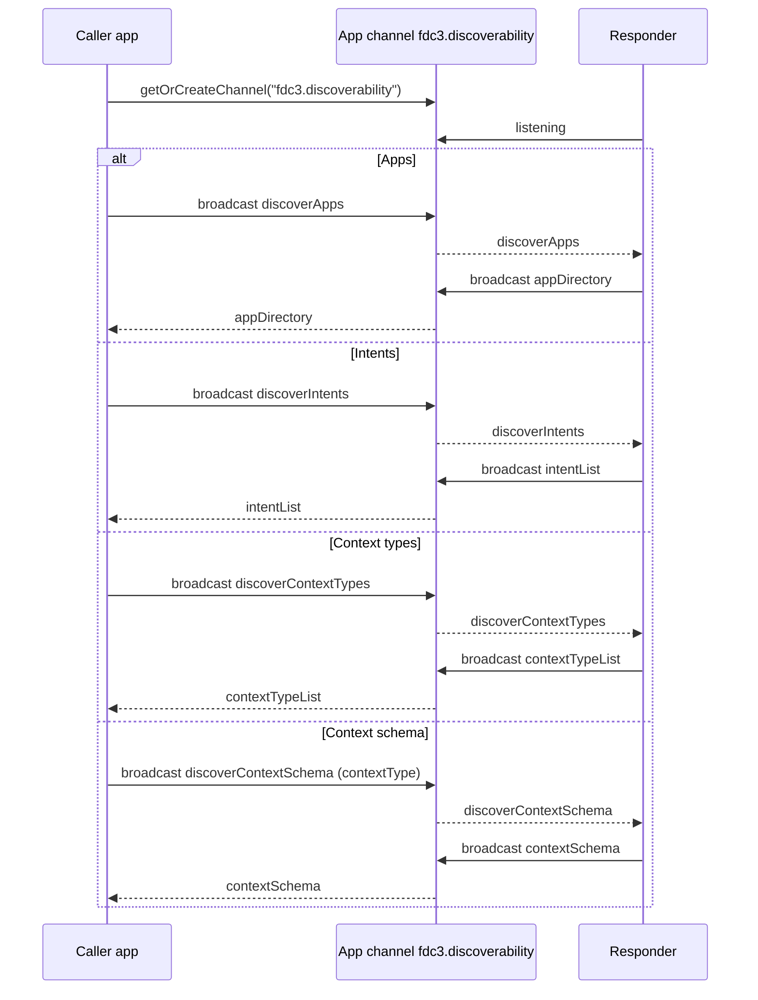

# `fdc3.discoverability` — capability discovery

Proposed FDC3 extension for **catalog-style discovery** of apps, intents, context types, and **JSON Schemas for a given context type** on a Desktop Agent.

An app joins (or creates) the dedicated **app channel** `fdc3.discoverability`, broadcasts a discovery request, and listeners that own a catalog reply with a single context carrying the answer. Typical responder is an agent harness or another platform app that knows the App Directory / capability set.

This is separate from:

- Session conversation under [`fdc3.ai`](../fdc3.ai/) (PrivateChannel streaming)
- Dataset advertising under [`fdc3.data`](../fdc3.data/) (user-channel offers)
- Runtime resolution via Desktop Agent `findIntent` / `findIntentsByContext` (also exposed as `fdc3_*` tools)

## Flow



## Request → reply pairs

| Ask for | Broadcast (request) | Reply (response) |
| --- | --- | --- |
| Apps | [`fdc3.discoverability.discoverApps`](schemas/discoverApps.schema.json) | [`fdc3.discoverability.appDirectory`](schemas/appDirectory.schema.json) — slim app entries (`appId`, `title`, `description`) |
| Intents | [`fdc3.discoverability.discoverIntents`](schemas/discoverIntents.schema.json) | [`fdc3.discoverability.intentList`](schemas/intentList.schema.json) — intent names + `purpose` (+ optional metadata) |
| Context types | [`fdc3.discoverability.discoverContextTypes`](schemas/discoverContextTypes.schema.json) | [`fdc3.discoverability.contextTypeList`](schemas/contextTypeList.schema.json) — `contextType` + optional `name` / `description` / schema URL |
| Context schema | [`fdc3.discoverability.discoverContextSchema`](schemas/discoverContextSchema.schema.json) | [`fdc3.discoverability.contextSchema`](schemas/contextSchema.schema.json) — JSON Schema for one `contextType` |

| Concept | Role |
| --- | --- |
| App channel `fdc3.discoverability` | Shared discovery bus. Distinct from session PrivateChannels and from user-channel data offers. |
| `discoverApps` | Caller → channel. “Which apps are available?” |
| `appDirectory` | Responder → channel. Slim app catalog (`appId`, optional `title` / `description`). |
| `discoverIntents` | Caller → channel. “Which intents can I raise?” |
| `intentList` | Responder → channel. Intent catalog entries (`name`, required `purpose`, optional display/contexts/resultType). |
| `discoverContextTypes` | Caller → channel. “Which context types are in play?” |
| `contextTypeList` | Responder → channel. Context type catalog entries (`contextType`, optional `name` / `description` / `schemaUrl`). |
| `discoverContextSchema` | Caller → channel. “What is the JSON Schema for this `contextType`?” |
| `contextSchema` | Responder → channel. Schema document (`schema` + optional `schemaUrl`), or `error` when unknown. |

## Context schema lookup

`fdc3.discoverability.discoverContextSchema` asks for the **JSON Schema** that defines a single context type. The request must include `contextType` (exact FDC3 `type` string). The reply echoes that type and, when found, includes:

| Field | Meaning |
| --- | --- |
| `contextType` | Echo of the request. |
| `schema` | The JSON Schema object (draft-07) for that context. |
| `schemaUrl` | Canonical `$id` / published URI when known. |
| `error` | Present when no schema is registered; `schema` is omitted. |

Request / reply example:

```json
{
  "type": "fdc3.discoverability.discoverContextSchema",
  "contextType": "fdc3.data.markdown"
}
```

```json
{
  "type": "fdc3.discoverability.contextSchema",
  "contextType": "fdc3.data.markdown",
  "schemaUrl": "https://fdc3.finos.org/schemas/next/context/data.markdown.schema.json",
  "schema": { "$schema": "http://json-schema.org/draft-07/schema#", "type": "object" }
}
```

In AIPA, the discoverability responder resolves schemas in this order:

1. Local [`fdc3-extensions/*/schemas`](../) (including suite [`demo.*` types](../demo/))
2. Published standard context JSON Schemas from [`@finos/fdc3-context`](https://www.npmjs.com/package/@finos/fdc3-context) (`dist/schemas/context`) — `title`, `description`, and `$id` populate `name` / `description` / `schemaUrl` on `contextTypeList`
3. FDC3 CDN `https://fdc3.finos.org/schemas/next/context/<type-without-fdc3-prefix>.schema.json` for other `fdc3.*` types

Unknown types return `error`. (`@finos/fdc3-schema` is the DACP/API package and is not used for context-type catalogs.)

Agents should use this when building a context payload (after discovering the type name), not as a substitute for `discoverContextTypes`.

## Intent `purpose` (App Directory extension)

`fdc3.discoverability.intentList` requires a **`purpose`** string on every intent entry: a short explanation of *when / why* a caller should raise that intent. Agents and planners use it to choose among catalog intents without inventing names or guessing semantics from `displayName` alone.

`purpose` is **not** part of the standard FDC3 App Directory `Application` schema. AIPA carries it as an extra property on each intent under `interop.intents.listensFor` in the app’s AppD record. The discoverability responder copies it into the channel reply; intents without a non-empty `purpose` are omitted from the catalog.

```json
{
  "appId": "aipa-market-data",
  "interop": {
    "intents": {
      "listensFor": {
        "ViewChart": {
          "displayName": "View Chart",
          "purpose": "Open a price chart for an instrument in the market-data UI.",
          "contexts": ["fdc3.instrument"]
        }
      }
    }
  }
}
```

Reply shape (see [`intentList.schema.json`](schemas/intentList.schema.json)):

```json
{
  "type": "fdc3.discoverability.intentList",
  "intents": [
    {
      "name": "ViewChart",
      "purpose": "Open a price chart for an instrument in the market-data UI.",
      "displayName": "View Chart",
      "contexts": ["fdc3.instrument"]
    }
  ]
}
```

When the same intent name is declared by multiple apps, the catalog merges `contexts` and keeps a single `purpose` (joining distinct purpose strings with ` | ` if they differ).

## How this relates to other discovery

| Mechanism | Discovers | Channel / API |
| --- | --- | --- |
| `fdc3.discoverability` (this package) | Apps / intents / context types / context schemas for planning | App channel `fdc3.discoverability` |
| [`fdc3.data` advertiseDatasets](../fdc3.data/) | Shareable **datasets** (not apps) | User channel |
| Desktop Agent `findIntent` / `findIntentsByContext` | Runtime handlers for a specific intent or context | Direct API |

Discovery here is catalog-oriented (what exists / what can I call / what shape does a context have). `findIntent` remains the right tool when you already know an intent or context and need a live resolution.

## AIPA implementation

| Piece | Role |
| --- | --- |
| [`server-apps/discoverability`](../../server-apps/discoverability/) | Responder app (port **4109**). Listens on the channel and replies from the combined App Directory (`GET /api/catalog`) and schema lookup (`GET /api/context-schema?contextType=`). |
| Agent harness tools | `fdc3_discover_apps` / `fdc3_discover_intents` / `fdc3_discover_context_types` / `fdc3_discover_context_schema` — browser-executed request/reply loop on channel `fdc3.discoverability`. |

## Schemas

JSON Schema definitions (draft-07), same composition pattern as [`@finos/fdc3` context schemas](https://github.com/finos/FDC3/tree/main/packages/fdc3-context/schemas/context): each type `allOf`s [`context.schema.json#/definitions/BaseContext`](schemas/context.schema.json).

| File | `type` |
| --- | --- |
| [`schemas/discoverApps.schema.json`](schemas/discoverApps.schema.json) | `fdc3.discoverability.discoverApps` |
| [`schemas/appDirectory.schema.json`](schemas/appDirectory.schema.json) | `fdc3.discoverability.appDirectory` |
| [`schemas/discoverIntents.schema.json`](schemas/discoverIntents.schema.json) | `fdc3.discoverability.discoverIntents` |
| [`schemas/intentList.schema.json`](schemas/intentList.schema.json) | `fdc3.discoverability.intentList` |
| [`schemas/discoverContextTypes.schema.json`](schemas/discoverContextTypes.schema.json) | `fdc3.discoverability.discoverContextTypes` |
| [`schemas/contextTypeList.schema.json`](schemas/contextTypeList.schema.json) | `fdc3.discoverability.contextTypeList` |
| [`schemas/discoverContextSchema.schema.json`](schemas/discoverContextSchema.schema.json) | `fdc3.discoverability.discoverContextSchema` |
| [`schemas/contextSchema.schema.json`](schemas/contextSchema.schema.json) | `fdc3.discoverability.contextSchema` |
