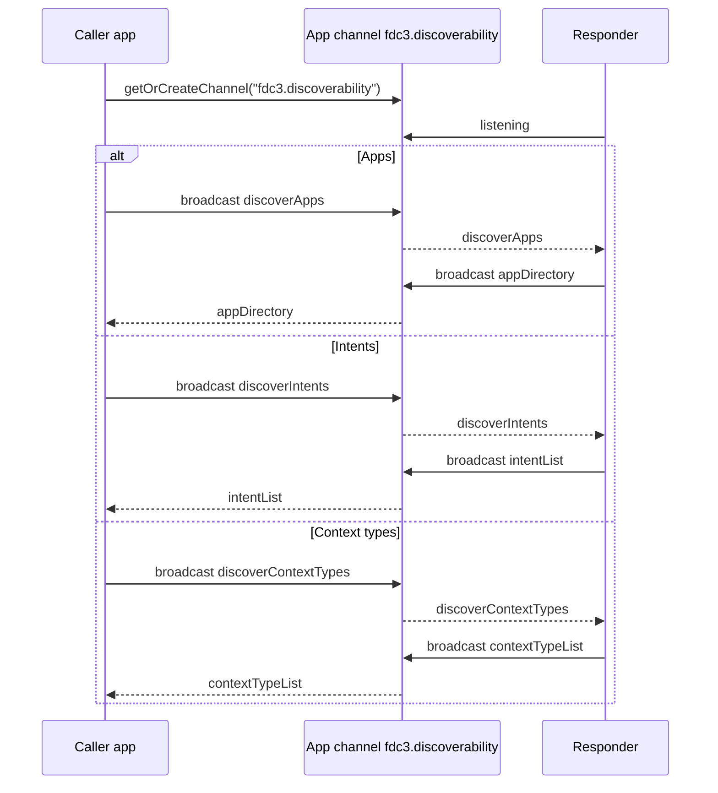

# `fdc3.discoverability` — capability discovery

Proposed FDC3 extension for **catalog-style discovery** of apps, intents, and context types on a Desktop Agent.

An app joins (or creates) the dedicated **app channel** `fdc3.discoverability`, broadcasts a discovery request, and listeners that own a catalog reply with a single context carrying the answer. Typical responder is an agent harness or another platform app that knows the App Directory / capability set.

This is separate from:

- Session conversation under [`fdc3.ai`](../fdc3.ai/) (PrivateChannel streaming)
- Dataset advertising under [`fdc3.data`](../fdc3.data/) (user-channel offers)
- Runtime resolution via Desktop Agent `findIntent` / `findIntentsByContext` (also exposed as `fdc3_*` tools)

## Flow

## Request → reply pairs

| Ask for | Broadcast (request) | Reply (response) |
| --- | --- | --- |
| Apps | [`fdc3.discoverability.discoverApps`](schemas/discoverApps.schema.json) | [`fdc3.discoverability.appDirectory`](schemas/appDirectory.schema.json) — App Directory records |
| Intents | [`fdc3.discoverability.discoverIntents`](schemas/discoverIntents.schema.json) | [`fdc3.discoverability.intentList`](schemas/intentList.schema.json) — intent names (+ optional metadata) |
| Context types | [`fdc3.discoverability.discoverContextTypes`](schemas/discoverContextTypes.schema.json) | [`fdc3.discoverability.contextTypeList`](schemas/contextTypeList.schema.json) — context `type` strings (+ optional schema URLs) |

| Concept | Role |
| --- | --- |
| App channel `fdc3.discoverability` | Shared discovery bus. Distinct from session PrivateChannels and from user-channel data offers. |
| `discoverApps` | Caller → channel. “Which apps (AppD records) are available?” |
| `appDirectory` | Responder → channel. Set of App Directory [`Application`](https://fdc3.finos.org/schemas/next/appd.schema.json#/components/schemas/Application) records. |
| `discoverIntents` | Caller → channel. “Which intents can I raise?” |
| `intentList` | Responder → channel. Intent catalog entries. |
| `discoverContextTypes` | Caller → channel. “Which context types are in play?” |
| `contextTypeList` | Responder → channel. Context type catalog entries. |

## How this relates to other discovery

| Mechanism | Discovers | Channel / API |
| --- | --- | --- |
| `fdc3.discoverability` (this package) | Apps / intents / context types for planning | App channel `fdc3.discoverability` |
| [`fdc3.data` advertiseDatasets](../fdc3.data/) | Shareable **datasets** (not apps) | User channel |
| Desktop Agent `findIntent` / `findIntentsByContext` | Runtime handlers for a specific intent or context | Direct API |

Discovery here is catalog-oriented (what exists / what can I call). `findIntent` remains the right tool when you already know an intent or context and need a live resolution.

## AIPA implementation

| Piece | Role |
| --- | --- |
| [`server-apps/discoverability`](../../server-apps/discoverability/) | Responder app (port **4109**). Listens on the channel and replies from the combined App Directory (`GET /api/catalog`). |
| Agent harness tools | `fdc3_discover_apps` / `fdc3_discover_intents` / `fdc3_discover_context_types` — browser-executed request/reply loop on channel `fdc3.discoverability`. |

## Schemas

JSON Schema definitions (draft-07), same composition pattern as [`@finos/fdc3` context schemas](https://github.com/finos/FDC3/tree/main/packages/fdc3-context/schemas/context): each type `allOf`s [`context.schema.json#/definitions/BaseContext`](schemas/context.schema.json).

| File | `type` |
| --- | --- |
| [`schemas/discoverApps.schema.json`](schemas/discoverApps.schema.json) | `fdc3.discoverability.discoverApps` |
| [`schemas/appDirectory.schema.json`](schemas/appDirectory.schema.json) | `fdc3.discoverability.appDirectory` |
| [`schemas/discoverIntents.schema.json`](schemas/discoverIntents.schema.json) | `fdc3.discoverability.discoverIntents` |
| [`schemas/intentList.schema.json`](schemas/intentList.schema.json) | `fdc3.discoverability.intentList` |
| [`schemas/discoverContextTypes.schema.json`](schemas/discoverContextTypes.schema.json) | `fdc3.discoverability.discoverContextTypes` |
| [`schemas/contextTypeList.schema.json`](schemas/contextTypeList.schema.json) | `fdc3.discoverability.contextTypeList` |
