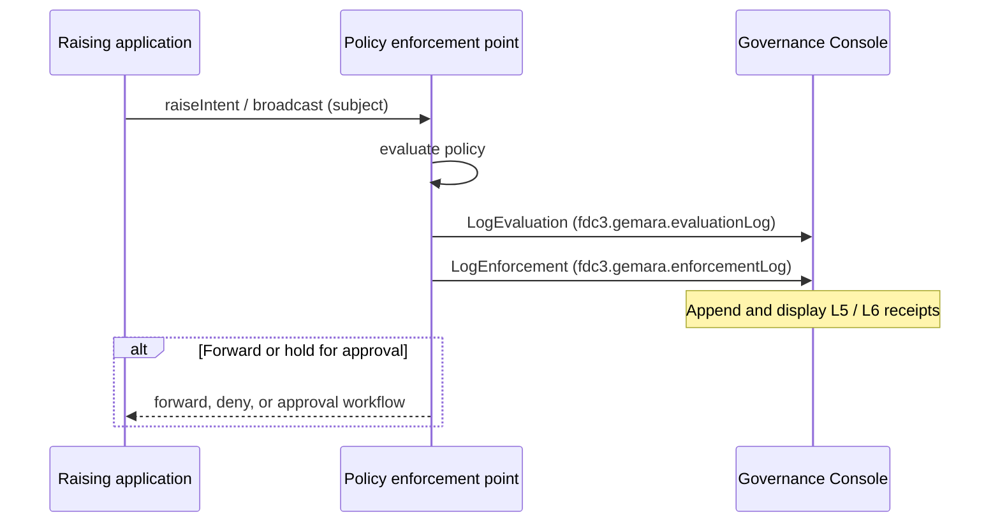

# `fdc3.gemara` — Gemara evidence via FDC3

Proposed FDC3 extension for **appending Gemara layer 5 and 6 receipts** (Evaluation Log and Enforcement Log) to a dedicated **Governance Console** application. Policy decision points (for example a Sail governance extension) raise log intents; the Console owns durable display of those receipts. The Console does not evaluate policy.

Gemara document shapes follow the [OpenSSF Gemara schema](https://gemara.openssf.org/schema/) (Evaluation Log / Enforcement Log). This extension wraps each document as an FDC3 context so Desktop Agents can route them with ordinary intents.

## Roles

| Piece | Role |
| --- | --- |
| Policy enforcement point (PEP) | After each decision, raises `LogEvaluation` and `LogEnforcement` with the corresponding Gemara documents. Does not render the logs. |
| Governance Console | FDC3 application that listens for those intents, appends receipts, and shows evaluation and enforcement tables. |
| Raising / target apps | Unaware of Gemara logging. |

How Sail governance uses this together with [`fdc3.approval`](../fdc3.approval/README.md) is summarised in [`../fdc3.approval/sail-governance.md`](../fdc3.approval/sail-governance.md).

## Flow



Appends are fire-and-forget: no IntentResult is required. The Console may still acknowledge with an empty result. Query or clear intents are out of scope for the initial proposal.

## Intents and contexts

| Intent | Input context | Purpose | Result |
| --- | --- | --- | --- |
| `LogEvaluation` | [`fdc3.gemara.evaluationLog`](schemas/evaluationLog.schema.json) | Append one Gemara Evaluation Log (layer 5) receipt. | None required. |
| `LogEnforcement` | [`fdc3.gemara.enforcementLog`](schemas/enforcementLog.schema.json) | Append one Gemara Enforcement Log (layer 6) receipt. | None required. |

Only the Governance Console (or another authorised evidence store) should listen for these intents. Raising them to an arbitrary app is not a substitute for authenticated audit storage in production.

### Governance Console

The Console is an ordinary FDC3 web application. When launched without context it opens the log UI (evaluation and enforcement). On `LogEvaluation` / `LogEnforcement` it validates `type`, extracts the Gemara document from `log`, appends it (newest first), and refreshes the view. Receipts are append-only. The AIPA demo persists them under the Console app’s `temp/` directory.

### `fdc3.gemara.evaluationLog`

Carries one Evaluation Log document in `log`. Optional `id.logId` mirrors `log.metadata.id` for App Directory / resolver hints. Optional `name` is a short display label.

| Field | Required | Meaning |
| --- | --- | --- |
| `type` | Yes | `fdc3.gemara.evaluationLog`. |
| `log` | Yes | Gemara Evaluation Log object (`metadata.type` is `EvaluationLog`). |
| `id.logId` | No | Same as `log.metadata.id` when known. |
| `name` | No | Short label for resolvers / UI. |

```json
{
  "type": "fdc3.gemara.evaluationLog",
  "id": { "logId": "sail-eval-uuid-1" },
  "name": "Inspection of demo.SubmitOrder",
  "log": {
    "metadata": {
      "id": "sail-eval-uuid-1",
      "type": "EvaluationLog",
      "version": "0.1.0",
      "gemara-version": "1.2.0",
      "date": "2026-10-26T18:00:00Z",
      "description": "Inspection of demo.SubmitOrder from aipa-agent-ui: REQUIRE_APPROVAL",
      "author": {
        "id": "sail-governance",
        "name": "Sail Governance",
        "type": "Software",
        "version": "0.0.0"
      }
    },
    "result": "Needs Review",
    "target": { "id": "aipa-agent-ui", "name": "aipa-agent-ui", "type": "Software" },
    "evaluations": []
  }
}
```

### `fdc3.gemara.enforcementLog`

Same wrapping pattern for an Enforcement Log (`metadata.type` is `EnforcementLog`).

| Field | Required | Meaning |
| --- | --- | --- |
| `type` | Yes | `fdc3.gemara.enforcementLog`. |
| `log` | Yes | Gemara Enforcement Log object. |
| `id.logId` | No | Same as `log.metadata.id` when known. |
| `name` | No | Short label for resolvers / UI. |

```json
{
  "type": "fdc3.gemara.enforcementLog",
  "id": { "logId": "sail-enf-uuid-1" },
  "name": "Held demo.SubmitOrder and raised GetApproval",
  "log": {
    "metadata": {
      "id": "sail-enf-uuid-1",
      "type": "EnforcementLog",
      "version": "0.1.0",
      "gemara-version": "1.2.0",
      "date": "2026-10-26T18:00:00Z",
      "description": "Held demo.SubmitOrder and raised GetApproval",
      "author": {
        "id": "sail-governance",
        "name": "Sail Governance",
        "type": "Software",
        "version": "0.0.0"
      }
    },
    "disposition": "Enforced",
    "target": { "id": "aipa-agent-ui", "name": "aipa-agent-ui", "type": "Software" },
    "actions": []
  }
}
```

## Schemas

JSON Schema definitions (draft-07), same composition pattern as other AIPA extensions: each type `allOf`s [`context.schema.json#/definitions/BaseContext`](schemas/context.schema.json).

| File | `type` |
| --- | --- |
| [`schemas/evaluationLog.schema.json`](schemas/evaluationLog.schema.json) | `fdc3.gemara.evaluationLog` |
| [`schemas/enforcementLog.schema.json`](schemas/enforcementLog.schema.json) | `fdc3.gemara.enforcementLog` |

Full Gemara field validation remains the Gemara schema’s responsibility; these FDC3 schemas require `type` and a `log` object and constrain `log.metadata.type`.
