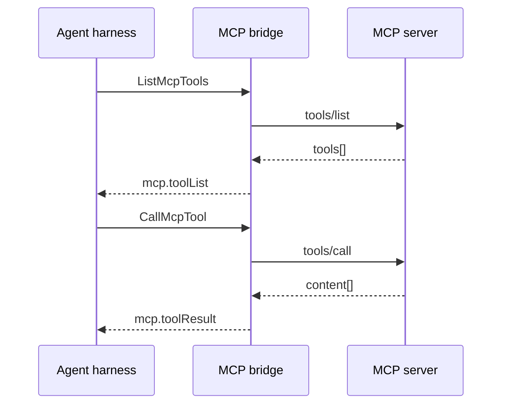

# `fdc3.mcp` — MCP bridge

Today Workspace’s browser (future Desktop Agent) holds MCP connections and the agent asks via `execute_agent_tool` SSE. In the FDC3 design that responsibility moves to a dedicated app (`openbb.mcp-bridge`) so the **agent harness only knows Desktop Agent intents** — it asks the bridge for tool descriptors, then to invoke a tool, and gets typed contexts back. MCP wire format never reaches the model loop.

Contexts live under `fdc3.mcp.*` (split out from the agent conversation namespace in [`fdc3.ai`](../fdc3.ai/)). Agent UI ↔ harness streaming stays in `fdc3.ai.*`; data apps in [`fdc3.data`](../fdc3.data/).

## Flow

| Intent | Context | Result | Role |
| --- | --- | --- | --- |
| `ListMcpTools` | [`fdc3.mcp.listQuery`](schemas/listQuery.schema.json) | [`fdc3.mcp.toolList`](schemas/toolList.schema.json) | Optional filter by `serverId`. Catalog (name, description, inputSchema, serverId) for the model’s tool registry. |
| `CallMcpTool` | [`fdc3.mcp.toolCall`](schemas/toolCall.schema.json) | [`fdc3.mcp.toolResult`](schemas/toolResult.schema.json) | Invoke one tool with `serverId`, `toolName`, `arguments` (plus optional agent decorations). Result maps MCP `content[]`. |
| `ManageMcpServers` | _(implementation-defined)_ | — | Optional CRUD for connect / disconnect / refresh — settings UI; harness usually only lists and calls. |

**Why a separate app:** keeps MCP auth, transport, and schema translation out of the agent harness and out of Desktop Agent core. Any FDC3 agent can reuse the same bridge.

## Context types

| Context type | From | To | Role |
| --- | --- | --- | --- |
| [`fdc3.mcp.listQuery`](schemas/listQuery.schema.json) | Agent harness | MCP bridge | Ask which tools are available. |
| [`fdc3.mcp.toolList`](schemas/toolList.schema.json) | MCP bridge | Agent harness | Tool catalog for the LLM. |
| [`fdc3.mcp.toolCall`](schemas/toolCall.schema.json) | Agent harness | MCP bridge | Invoke one MCP tool. |
| [`fdc3.mcp.toolResult`](schemas/toolResult.schema.json) | MCP bridge | Agent harness | Normalized tool output. |

> **Note on naming:** the review HTML nested these under `fdc3.ai.mcp*`. This package uses the dedicated `fdc3.mcp.*` namespace so MCP can version and ship independently of the agent PrivateChannel contract.

## Schemas

JSON Schema definitions (draft-07), same composition pattern as [`@finos/fdc3` context schemas](https://github.com/finos/FDC3/tree/main/packages/fdc3-context/schemas/context): each type `allOf`s [`context.schema.json#/definitions/BaseContext`](schemas/context.schema.json).

| File | `type` |
| --- | --- |
| [`schemas/listQuery.schema.json`](schemas/listQuery.schema.json) | `fdc3.mcp.listQuery` |
| [`schemas/toolList.schema.json`](schemas/toolList.schema.json) | `fdc3.mcp.toolList` |
| [`schemas/toolCall.schema.json`](schemas/toolCall.schema.json) | `fdc3.mcp.toolCall` |
| [`schemas/toolResult.schema.json`](schemas/toolResult.schema.json) | `fdc3.mcp.toolResult` |
