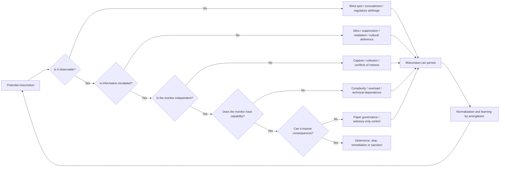

# Can Governance Restrain Bad Actors? Evidence on Organisational Controls, Capture, Enforcement and Failure

## Executive summary

The strongest conclusion from the literature is **no: a mature governance framework does not have to be “corrupted” in the narrow sense—bribed, captured or deliberately subverted—before serious organisational misconduct can occur**. Misconduct can persist because the control system does not observe it, information is filtered before reaching decision-makers, responsibility is fragmented, monitors lack technical competence or resources, incentives discourage challenge, sanctions are weak, or harmful practices become culturally normalised. Enron, Wells Fargo and Wirecard all exhibited functioning formal governance structures while important control layers failed for combinations of these reasons. citeturn19view0turn19view1turn19view3

That conclusion depends, however, on using “corruption” precisely. If corruption is defined so broadly that *any* failure of a governance mechanism counts as corruption, the proposition becomes tautological: misconduct can persist only when governance does not stop it. The analytically useful distinction is between **capture/collusion**, **bypass/blind spots**, **incapacity/fragmentation**, and **cultural or incentive-driven drift**. Only the first necessarily involves corruption of the guardian itself. Classical principal–agent theory, Tirole's work on collusion in hierarchies, regulatory-capture theory, and organisational research on the normalisation of wrongdoing all point to distinct mechanisms. citeturn1search0turn1search2turn1search11turn12search16turn12search37

There is nevertheless substantial evidence that **empowered governance can act as a real brake rather than merely as paperwork**. A cross-national meta-analysis of 135 studies found a generally negative relationship between board independence and misconduct, although the effect depends strongly on what kind of independence is implemented and on the surrounding institutional environment. A large study of nearly two million internal whistleblowing reports at more than 1,000 US public companies found greater use of internal reporting systems associated with fewer and smaller subsequent government fines and material lawsuits. citeturn16view1turn16view2

More persuasive still are studies exploiting changes in enforcement. Berger and Lee's study of the Dodd–Frank whistleblower provisions estimates that exposure to the new regime reduced the likelihood of accounting fraud by roughly **12–22% relative to control firms**. Kedia and Rajgopal found that firms facing more salient/local SEC enforcement were less likely to restate financial statements. Heese, Krishnan and Ramasubramanian found that DOJ intervention in whistleblower-initiated fraud cases was followed by improvements in internal controls, employee relations and board independence and by lower subsequent whistleblowing risk; cases pursued privately without DOJ intervention did not exhibit the same effects. These designs are not equivalent to randomised trials, but together they are difficult to reconcile with a view that governance is intrinsically powerless until captured. citeturn14search2turn17search3turn18search0

The Wells Fargo case supplies a particularly concrete demonstration of **coercive external governance as a brake**. In 2018 the Federal Reserve prohibited the bank from growing beyond its end-2017 asset size until it improved governance and risk management. The Fed explicitly tied removal of the constraint to governance remediation. The growth restriction was ultimately removed after supervisory assessment of those reforms in 2025, and the remaining 2018 enforcement action was terminated in 2026. Whatever one thinks about the speed or sufficiency of the intervention, this is an example of an external governance body having actual power to constrain the organisation's strategic freedom rather than merely issuing recommendations. citeturn19view2turn8search3turn8search0

The evidence therefore supports a more precise proposition:

> **Governance does not have to be corrupt to fail. But governance can constrain powerful or badly motivated actors when it possesses independent information, independence from the actor being monitored, credible escalation channels, sufficient technical and investigative capacity, and enforceable authority to impose costs or stop activity.**

An analytically useful representation is:

\[
U_{\text{misconduct}}
=
B-
p_Dp_Ep_A L-C
\]

where \(B\) is the private benefit of misconduct, \(p_D\) the probability it is detected, \(p_E\) the probability that detection is successfully escalated, \(p_A\) the probability that an empowered authority actually acts, \(L\) the resulting loss or sanction, and \(C\) the actor's intrinsic/reputational/career cost. This is a synthesis rather than an estimated structural model, but it captures the empirical mechanisms well. Corrupting the monitor reduces \(p_A\); concealing behaviour reduces \(p_D\); silencing whistleblowers reduces \(p_E\); weak sanctions reduce \(L\); cultural normalisation can reduce \(C\). **A bad actor therefore need not capture the entire governance apparatus. It may be enough to defeat one link in the chain.** The deterrence and organisational literature strongly supports this weakest-link interpretation. citeturn1search2turn17search3turn12search16turn19view1

For advanced organisations such as frontier-AI firms, the implication is important. The design target should not be “a good governance framework” in the abstract. It should be a **control architecture whose information and stopping power remain outside the unilateral control of the activity being governed**. Existing AI-risk frameworks already emphasise continuous governance, measurement and risk management, but the corporate-governance evidence suggests these functions become materially stronger when coupled to independent information, protected escalation and hard intervention rights. NIST's AI Risk Management Framework organises risk management around Govern, Map, Measure and Manage; the UK AI Security Institute explicitly develops independent capability testing and mitigation infrastructure; and US DOJ guidance in 2026 was asking whether compliance personnel are involved when AI and algorithmic tools are deployed and how their risks are assessed and mitigated. citeturn21search16turn21search18turn21search15

**Overall assessment:** the evidence is considerably stronger for the proposition **“empowered, independent and informed governance reduces misconduct”** than for **“bad organisational behaviour requires governance first to be corrupted”**. What the evidence does *not* support is the stronger claim that mature governance can reliably prevent all misconduct. Governance is probabilistic and adversarial: effective systems raise detection, escalation and intervention probabilities; they do not make them one.

## Governance, agency and control as a strategic problem

The canonical starting point is the separation between those who control resources and those whose interests the organisation is nominally intended to serve. Jensen and Meckling formalised the corporation as a nexus of contracts in which principals incur monitoring and bonding costs because agents may pursue their own objectives; Fama and Jensen subsequently emphasised the separation of **decision management** from **decision control** as an organisational response to agency problems. Governance, in this view, is not primarily a statement of values. It is an architecture for limiting the feasible behaviour of agents whose incentives are imperfectly aligned with those of principals. citeturn1search0turn1search27

That distinction matters for the present question. A governance system has force only insofar as it changes either an actor's information set, feasible actions, incentives or consequences. A code of conduct without monitoring does little to \(p_D\); an audit function whose findings can be suppressed does little to \(p_E\); an independent committee without stop authority does little to \(p_A L\). Contemporary governance standards implicitly recognise this. The 2023 G20/OECD Principles assign boards responsibility for overseeing internal-control systems and stress confidential, independent whistleblowing arrangements; the Basel Committee similarly treats board oversight, risk management and independent control functions as integral to effective bank governance; COSO's internal-control framework includes monitoring alongside the control environment, risk assessment, control activities, and information and communication. citeturn11search0turn11search1turn11search2

**Collusion introduces a second agency problem: who monitors the monitor?** Tirole's model of hierarchies shows that once a supervisor possesses information valuable to the principal, the supervisor and subordinate may be able to form a coalition that suppresses or distorts that information. Effective organisational design therefore has to be robust not merely to an opportunistic employee but to coalitions between monitored actors and guardians. citeturn1search2

Regulatory capture is the external analogue. Laffont and Tirole's agency-theoretic treatment of capture makes information asymmetry central: a regulator or political principal depends on information supplied by affected parties, creating opportunities for organised interests to influence the regulatory process. Capture therefore need not resemble an envelope of cash changing hands. Dependencies, information advantages and concentrated interests can weaken independent control without extinguishing the regulatory institution itself. citeturn1search11

A third body of theory challenges the premise that serious misconduct always begins with a consciously “bad actor”. Ashforth and Anand describe organisational corruption becoming normalised through **institutionalisation** of practices, **rationalisation** of them and **socialisation** of newcomers. Palmer's work on “normal organisational wrongdoing” likewise argues that wrongdoing can arise through ordinary organisational processes rather than exclusively through exceptional deviant individuals. This matters because governance designed solely to identify malicious personalities can miss harmful equilibria produced by routines, targets and local norms. citeturn12search16turn12search37

Putting these traditions together gives four analytically separate ways governance can cease to constrain behaviour:

| Failure class | What actually breaks | Must the guardian itself be corrupt? |
|---|---|---|
| **Capture or collusion** | Monitor's incentives/loyalty become aligned with the monitored actor | **Yes, in a meaningful sense** |
| **Bypass or arbitrage** | Misconduct takes place outside what the control measures or observes | **No** |
| **Overload, fragmentation or information failure** | Governance cannot aggregate, understand or escalate available signals | **No** |
| **Cultural/incentive drift** | Behaviour is locally rewarded or normalised faster than controls respond | **No** |

This taxonomy is consistent with the theoretical and case literature and is more informative than labelling every unsuccessful control “corrupt”. citeturn1search2turn1search11turn12search16turn19view1turn19view3

It also suggests that **formal governance maturity and effective constraint are different variables**. A mature organisation may possess a board, audit committee, compliance department, risk function, external auditor, hotline and regulator and nevertheless have a low product \(p_Dp_Ep_A\). Conversely, a relatively simple organisation with a genuinely independent monitor possessing direct information and veto authority may impose a strong constraint. The meta-analytic evidence on boards is consistent with this: the relationship between independence and misconduct is generally favourable but varies materially depending on how independence is implemented and on the national institutional environment. citeturn16view1

## What the empirical record says

The empirical literature does **not** support either extreme proposition—neither “governance always works” nor “governance is ceremonial until corrupted”. The picture is conditional, with stronger results where monitoring is independent, observable to potential offenders and attached to credible consequences. citeturn16view1turn16view0turn17search3

**Independent boards have a measurable but modest effect.** Neville, Byron, Post and Ward's cross-national meta-analysis pooled 135 studies from more than 20 countries. It found that greater board independence is generally associated with less corporate misconduct, but the magnitude varies according to whether independence resides in the whole board, audit committee, or separation of CEO/chair roles. Importantly, the negative relationship is stronger in countries with lower levels of corruption. That is strong evidence for a boundary-condition view: an independent board can constrain management, but its effectiveness partly depends on the institutional environment surrounding the firm. citeturn16view1

A newer meta-analysis by Braun and Mueller reaches a compatible conclusion for **external** corporate governance. It develops external monitoring as a process involving detection and sanction and finds mean effect sizes that are relatively small but comparable in magnitude with those found for internal governance mechanisms. This cautions against expecting any single guardian to dominate behaviour, while supporting the idea that outside scrutiny contributes an additional layer of constraint. citeturn16view0

**Whistleblowing provides unusually direct evidence that information channels can work.** Stubben and Welch analysed nearly two million reports submitted to internal whistleblowing systems at more than 1,000 listed US firms. Higher internal-report volume was associated with fewer and smaller subsequent government fines and material lawsuits. They specifically caution against interpreting many internal reports as evidence that an organisation is unhealthy: a heavily used reporting system can instead represent an open channel through which problems are identified while they are still manageable. The design is observational, so causation cannot be established from that association alone, but its scale makes it important evidence against the view that internal governance is inherently impotent. citeturn16view2

The evidence becomes stronger when an external whistleblower regime changes the expected cost of misconduct. Berger and Lee exploit firms' differential prior exposure to state False Claims Acts when examining the introduction of the Dodd–Frank whistleblower provision. They estimate that Dodd–Frank exposure reduced the likelihood of accounting fraud among treatment firms by approximately **12–22% relative to the comparison group**. A separate study by Wiedman reports a 9.3% post-program decline in its F-SCORE proxy for financial-reporting fraud and finds evidence consistent with firms strengthening internal whistleblowing arrangements in response to the external reporting regime. The latter result is less clean as causal evidence because it depends on a fraud-risk proxy and before/after identification, but it points in the same direction. citeturn14search2turn14search12

This is especially significant conceptually. An external regulator need not actually prosecute every offender to affect behaviour. By making credible external escalation possible, it changes the bargaining position of internal employees and compliance staff. In effect:

\[
\text{strong external escape route}
\rightarrow
\text{credible internal reporting}
\rightarrow
\text{greater expected detection}
\rightarrow
\text{deterrence}.
\]

The inference is supported by the Dodd–Frank findings and by Stubben and Welch's evidence on active internal systems. citeturn14search2turn16view2

Dyck, Morse and Zingales's study of large US corporate frauds complements this result from the detection side. They find that fraud discovery is distributed among multiple actors rather than monopolised by any canonical guardian; employees, regulators, auditors, media and other outsiders all contribute. The structural lesson is **redundancy**: governance is stronger when a manager has to defeat several differently situated information channels rather than a single monitor. citeturn2search23

**External enforcement also changes behaviour.** Kedia and Rajgopal found that companies closer to SEC offices, and companies in areas with greater past SEC enforcement activity, were less likely to restate their financial statements; the SEC was itself more likely to investigate nearby companies. Their interpretation is that perceived enforcement and the regulator's limited resources matter, with regulation more effective where enforcement is more salient. Because geography can correlate with other firm characteristics, this is not equivalent to a randomised intervention, but it directly links enforcement capacity to organisational behaviour. citeturn17search3

Heese, Krishnan and Ramasubramanian examine DOJ involvement in whistleblower-initiated fraud enforcement. Firms subject to DOJ intervention subsequently improved employee relations, internal controls and board independence and experienced lower future whistleblowing risk; cases pursued by whistleblowers without DOJ intervention did not have comparable effects. The same study finds that DOJ case selection is itself shaped by expected case success and proceeds, reminding us that enforcement agencies are resource-constrained agents too. citeturn18search0

The corporate scandals reveal *why* these probabilistic effects sometimes collapse.

**Enron is closer to a simultaneous gatekeeper failure than to evidence that governance must be absent.** A US Senate investigation described a multilayered system of watchdogs in which virtually none prevented or warned of the impending failure. Arthur Andersen knew that important transactions presented unusually high accounting risk and nevertheless failed in its gatekeeper role; Andersen earned $52 million from Enron in 2000, of which $27 million was consulting rather than audit work, creating an obvious independence concern. The board, meanwhile, possessed significant information about high-risk accounting and structured-finance vehicles but failed to probe obvious red flags adequately; Senate investigators also noted the limited time devoted to highly complex transactions. citeturn19view0

Enron therefore contains **both corruption-adjacent and non-corruption mechanisms**. Auditor conflicts and participation in transaction structuring resemble compromised gatekeeping. But board over-reliance on management, insufficient diligence and limited scrutiny need not imply collusion. The same organisation can exhibit capture in one layer and incapacity or passivity in another. citeturn19view0

**Wells Fargo is an even clearer counterexample to the idea that every guardian must first be captured.** The independent directors' investigation found that distorted sales incentives and aggressive performance management put employees under pressure to sell products customers did not need and sometimes open unauthorised accounts. The Community Bank's leadership resisted outside scrutiny and minimised the problem, but corporate control functions were also constrained by the company's decentralised structure and a culture of deference to business units. A transactional approach meant control functions failed to aggregate individual incidents into a systemic picture; management reporting to the board understated the scope of the problem. citeturn19view1

That is not simply “the governance system was bribed”. One business unit actively impeded scrutiny, while other guardians suffered **information aggregation, hierarchy and organisational-design failures**. Once those barriers were removed, the board replaced leadership, eliminated sales goals, accelerated centralisation of control functions, separated the chair and CEO roles, strengthened board committees and established direct reporting from a new ethics/oversight function. citeturn19view1

The Federal Reserve then supplied a harder external constraint. In February 2018 it prohibited Wells Fargo from growing beyond its end-2017 asset size until governance and risk management improved, explicitly finding that the firm's risk-management system had prevented serious compliance failures being properly escalated to the board. This is unusually important evidence because the intervention attacked the organisation's strategic objective—growth—rather than merely increasing paperwork. citeturn19view2

**Volkswagen's emissions scandal illustrates bypass through measurement arbitrage.** The US Environmental Protection Agency found software designed so that emissions controls behaved differently during official emissions testing than during normal driving, with real-world nitrogen-oxide emissions in affected vehicles reaching multiples of the applicable standard. This is governance failure through adversarial optimisation against the test: the regulator did not have to be captured if the regulated party could predict exactly what would be measured and optimise around that measurement. citeturn6search13turn6search4

**Wirecard illustrates fragmented external governance.** ESMA's peer review of German supervision identified deficiencies involving BaFin's independence controls, failure to select Wirecard's reports for timely risk-based examination, inadequate scope and professional scepticism in FREP's examinations, and disagreement between BaFin and FREP about their respective roles in suspected financial-reporting fraud. That is almost a textbook example of how apparently mature governance can fail because no single guardian has the information, jurisdiction and sense of responsibility required to intervene decisively. citeturn19view3

Taken together, these cases suggest that **large-scale misconduct usually requires some governance barrier to fail, but not necessarily a corrupt guardian**. Sustained misconduct can be achieved by remaining unobserved, by fragmenting information, by exploiting the test, by suppressing escalation, by exploiting weak competence, or by overwhelming the monitor. Capture is one strategy among several.

## How governance is corrupted, bypassed or overwhelmed

The mechanisms can be organised as a sequential control chain. The important implication is that a would-be wrongdoer does not need to defeat every component.

The pathways in this schematic correspond closely to the empirical record: predictable measurement enabled Volkswagen's test gaming; silos and filtered reporting mattered at Wells Fargo; auditor conflicts mattered at Enron; supervisory fragmentation and insufficient scepticism mattered at Wirecard; and enforcement salience appears to affect misconduct in the SEC evidence. citeturn6search13turn19view1turn19view0turn19view3turn17search3

**Capture and collusion** are the strongest versions of governance corruption. They matter particularly where the monitor's knowledge is difficult for anyone else to verify. Tirole's analysis makes this an endogenous coalition problem: once supervisors and agents can jointly benefit from concealing information, simply adding another hierarchical layer need not solve the principal's problem. Laffont and Tirole show an analogous vulnerability where regulated parties have informational and organisational advantages over public decision-makers. citeturn1search2turn1search11

**Regulatory arbitrage and measurement gaming** require no such coalition. A control built around a stable proxy creates an incentive to maximise the proxy rather than the underlying objective. Volkswagen is unusually stark because software could distinguish test conditions from real-world conditions, but the more general problem applies whenever governance observes a predictable subset of behaviour. citeturn6search13

**Information fragmentation** is another independent failure mode. Wells Fargo had extensive lower-level disciplinary activity, yet control functions approached problems transaction by transaction and failed for too long to assemble them into a system-level diagnosis. Wirecard's supervisory structure similarly suffered misalignment over responsibilities and inadequate flow of evaluative information between enforcement bodies. Neither mechanism requires the ultimate decision-maker positively to desire misconduct. citeturn19view1turn19view3

**Retaliation and channel suppression** attack escalation rather than detection. The whistleblowing literature repeatedly treats anonymity, retaliation protection and independence of the reporting recipient as material determinants of whether employees report. The SEC whistleblower regime is particularly informative because firms faced a credible route by which employees could bypass internal hierarchy; empirical studies find subsequent reductions in fraud-related proxies and accounting fraud. citeturn14search3turn14search7turn14search2turn14search12

**Cultural drift** can be more subtle still. Ashforth and Anand's model predicts that once questionable conduct becomes routinised and rationalised, newcomers learn that it is locally acceptable. Wells Fargo's independent investigation supplies a concrete corporate analogue: distorted sales culture and performance management transformed objectionable conduct into behaviour generated at significant scale by ordinary employees responding to organisational pressure. citeturn12search16turn19view1

This produces an important distinction between **local and global corruption**. An organisation may contain a badly behaved department while the board remains uninvolved; a business unit can manipulate information flowing upward; an auditor can be conflicted while a regulator remains independent; or a regulator can be ineffective while internal whistleblowers remain active. A robust governance architecture therefore benefits from **non-collinear failure modes**—monitors whose information sources, incentives and authority are sufficiently different that one actor cannot disable all of them with the same tactic. Dyck, Morse and Zingales's distributed fraud-detection evidence supports exactly this redundancy principle. citeturn2search23

This is also why “independence” should not be treated as a binary box on an organisational chart. Formal independence without independent information is weak; information without escalation rights is weak; escalation without consequences is weak. The cross-national board meta-analysis and the Enron and Wells Fargo investigations all point towards **functional independence**, rather than nominal status, as the relevant construct. citeturn16view1turn19view0turn19view1

## Simulation and agent-based evidence

The simulation literature is smaller and less directly corporate than the econometric literature, but it contributes something useful: it demonstrates that governance outcomes can exhibit **thresholds, path dependence and phase changes** rather than smooth responses to enforcement. It also highlights why a simulation should not simply hard-code “good agents” and “bad agents”. Behaviour can emerge from incentives, observations, sanctions and social interaction. citeturn20view0turn20view1

Hammond's 2000 agent-based model represents corruption as heterogeneous agents playing game-theoretic micro-interactions. The model can generate an endogenous transition from a high-corruption to a low-corruption equilibrium and examines the conditions under which such transitions occur. Its significance is conceptual rather than empirical: social systems need not be stuck permanently in the equilibrium implied by their initial level of misconduct, but nonlinear collective effects can make transitions difficult until a threshold is reached. citeturn20view0

Zausinová, Zoričak, Vološin and Gazda similarly use heterogeneous citizen and bureaucrat agents. Their simulations find strong dependence on initial conditions and established social norms; they also obtain transitions from corrupt to non-corrupt states under changes in the model's enforcement/information environment. This provides a computational analogue of organisational normalisation: expectations about what others will do can make misconduct self-reinforcing. citeturn20view1

Smojver's 2016 ABM is particularly relevant to resource-constrained governance. It models an inspector confronting entities subject to many rules rather than a single compliance decision. In the simplified simulations, inspection strategies that use information about the differing cost of compliance outperform random and simple cyclic inspection strategies. The author explicitly calls for wider testing and validation, so this should not be read as empirical proof of a particular enforcement policy; it is evidence that **inspection allocation itself is a strategic design variable**. citeturn20view2

Van Asselt, Osinga and Bremmers model Dutch pig farmers' compliance with antibiotics regulation using the “Table of Eleven”, incorporating economic, cognitive, social and institutional determinants. They vary social factors and the number of inspectors and show that the preferred inspection strategy changes with parameter settings. They also explicitly note that further model development, including richer economic factors, is needed to represent reality more closely. citeturn20view3

The common result across these models is therefore **not** “more inspection always works”. It is that outcomes depend on parameter regimes: history, norms, information, expected sanctions, inspector allocation and interaction structure can move the population between qualitatively different states. citeturn20view0turn20view1turn20view2turn20view3

That is an important methodological warning. Most governance ABMs demonstrate implications of assumed behavioural rules; they do not establish those rules empirically. Van Asselt et al. explicitly describe their work as an early attempt and identify omitted economic mechanisms; Smojver explicitly calls for further validation. Compared with the rich econometric literature on boards, whistleblowing and enforcement, **calibrated agent-based models of internal organisational governance remain relatively immature**. citeturn20view2turn20view3

For the question at hand, a promising simulation should therefore *not* start by inventing elaborate strategies for smart or malicious agents. A cleaner model would parameterise the control chain itself. For example:

\[
p_{\mathrm{stop}}
=
p_D
\times p_E
\times (1-c)
\times p_A
\]

where \(c\) is the probability that the relevant monitor is captured or colludes. A misconduct opportunity yielding benefit \(B\) and sanction \(L\) is unattractive when approximately:

\[
p_{\mathrm{stop}} L > B.
\]

This immediately produces distinct regimes:

\[
\text{high }c \Rightarrow \text{capture-dominated failure}
\]

\[
\text{low }c,\ \text{low }p_D \Rightarrow \text{bypass-dominated failure}
\]

\[
\text{high }p_D,\ \text{low }p_E \Rightarrow \text{suppression/fragmentation failure}
\]

\[
\text{high detection and escalation,\ low }L \Rightarrow \text{toothless-governance failure}.
\]

Unlike an ABM in which we program a “clever bad actor” to behave cleverly, this structure lets strategic behaviour arise from a small number of observable institutional conditions. That modelling direction is strongly suggested by both deterrence evidence and the documented failure modes in real organisations. citeturn17search3turn19view0turn19view1turn19view3

## Boundary conditions and implications for advanced organisations

The evidence allows a reasonably specific map of the parameter regimes in which governance is likely to function as a brake.

| Governance dimension | Regime favouring restraint | Regime favouring misconduct | Evidence |
|---|---|---|---|
| **Observability** | Independent access to raw information; unpredictable or real-world testing | Management controls data; predictable tests; hidden actions | Volkswagen shows the vulnerability of predictable compliance testing. citeturn6search13 |
| **Escalation** | Multiple protected routes directly to independent decision-makers | Hierarchical filtering, retaliation, departmental silos | Wells Fargo; whistleblower evidence. citeturn19view1turn14search2turn16view2 |
| **Monitor independence** | Financial, career and informational independence | Consulting conflicts, dependence on management, collusion | Enron; board-independence meta-analysis. citeturn19view0turn16view1 |
| **Authority** | Monitor can stop activity, remove leaders or impose binding constraints | Advice can be ignored without consequence | Federal Reserve's Wells Fargo growth restriction. citeturn19view2 |
| **Sanction credibility** | Potential offenders expect meaningful investigation and consequence | Enforcement remote, delayed or unlikely | SEC-enforcement study; DOJ intervention study. citeturn17search3turn18search0 |
| **Capacity and competence** | Resources/expertise scale with organisational complexity | Workload, technical complexity or fragmented jurisdiction overwhelms monitor | Wirecard; inspection ABMs. citeturn19view3turn20view2 |
| **Organisational culture** | Challenge is legitimate and reporting is normal | Performance pressure rationalises rule breaking | Wells Fargo; normalisation theory. citeturn19view1turn12search16 |
| **Redundancy** | Internal audit, board, staff, external auditors/regulators and outsiders have partially independent channels | Single gatekeeper is a common point of failure | Distributed detection in Dyck et al.; Enron's lesson about correlated gatekeeper failure. citeturn2search23turn19view0 |
| **Institutional environment** | External rule of law and low ambient corruption reinforce independent monitors | Surrounding institutions themselves tolerate capture | Board-independence effect is stronger in less-corrupt national environments. citeturn16view1 |

The most important implication is that **governance power is multiplicative rather than additive**. Five committees do not necessarily compensate for the fact that all five see the same management-curated dashboard. Three reporting channels do not provide redundancy if all reports terminate with the same executive. A regulator with large penalties is weak if detection is vanishingly rare. Conversely, even an imperfect monitor may be powerful if it independently sees the relevant activity and can immediately impose a high-cost constraint. This is an inference from the combined empirical literature rather than a directly estimated functional form. citeturn19view1turn19view2turn17search3

For an advanced AI organisation, that leads to a stronger governance design than the conventional “safety committee plus policy document”.

**The safety/control function should have independent information rights.** It should not depend exclusively on product teams for summaries of model capabilities, incidents or evaluation results. NIST's AI RMF already treats governance, mapping and measurement as integrated risk-management functions; the corporate record suggests that the *raw-data relationship* between operating units and monitors is at least as important as the formal committee structure. citeturn21search16turn19view1

**It should possess genuine stop authority.** A safety or compliance group that may advise senior management but cannot delay training, deployment or scaling is closer to \(p_A\approx0\) when commercial management disagrees. The Wells Fargo growth cap is a useful institutional analogue: the regulator made additional organisational growth conditional on governance adequacy. For high-consequence AI systems, an analogous design principle would make specified capability or deployment thresholds conditional on satisfying pre-defined control requirements. This is a policy inference, not a claim that banking regulation maps mechanically onto AI. citeturn19view2

**External evaluation should not reproduce the Volkswagen problem.** If developers know every evaluation, threshold and test condition in advance, they—or optimising internal processes—can disproportionately improve measured compliance without necessarily improving the underlying risk. Randomised tests, continuously updated evaluations, post-deployment monitoring and access to behaviours outside laboratory conditions reduce the gap between the proxy and the target. The UK AI Security Institute's role in building independent testing and mitigation infrastructure is directionally consistent with this approach. citeturn6search13turn21search18

**Whistleblowing should have an external escape path.** Internal reporting is valuable, but its credibility increases when an employee can bypass management and communicate with an independent board committee or regulator. The Dodd–Frank evidence suggests that credible external reporting can itself generate deterrence and can induce stronger internal mechanisms. For AI laboratories, protected reporting is especially important where the relevant information—unexpected capabilities, unsafe deployment practices, evaluation manipulation—may initially be visible to only a handful of technical staff. citeturn14search2turn16view2

**Monitor independence should include technical independence.** Traditional board governance generally focuses on financial and relational independence. In technically complex organisations there is an additional dependency: a nominally independent board may be unable to challenge management if only management can interpret the evidence. Wirecard's findings about insufficient professional scepticism and inappropriate examination scope, combined with Wells Fargo's information-filtering failures, imply that expertise and independent analytical capability belong inside the definition of independence. citeturn19view3turn19view1

**Governance capacity should scale with capability and organisational growth.** Kedia and Rajgopal's evidence that regulator resource constraints affect enforcement and the inspection-model literature both suggest that monitoring capacity is a scarce resource. In an organisation where technical capability or deployment surface grows faster than governance capacity, effective \(p_D\) may fall even while the governance department grows in absolute size. citeturn17search3turn20view2

**The monitors themselves need monitoring.** Enron demonstrates why external auditors cannot be assumed independent merely because they occupy a formally external position. Wirecard demonstrates that public supervisors likewise require conflict-of-interest controls and clear accountability. An AI-governance regime should therefore disclose and audit conflicts affecting evaluators, safety committees and external assessors rather than treating “independent evaluator” as a terminal category. citeturn19view0turn19view3

**Governance should be stress-tested adversarially.** Instead of asking whether policies exist, an organisation can inject synthetic but realistic warning signals and measure whether they are detected, escalated and acted upon: a suspicious evaluation result, a prohibited deployment request, a falsified metric, a senior executive pressuring staff to ignore a threshold, or an internal report implicating a high-status employee. The logic follows directly from the distinction between formal and effective control and fits NIST's emphasis on continual governance, measurement and management. citeturn21search16turn21search20

This also aligns with the direction of contemporary US corporate-compliance policy. In 2026 DOJ antitrust officials were explicitly asking whether corporate risk assessment covers AI and algorithmic revenue-management tools, whether compliance personnel participate in deployment decisions, and what mitigations accompany deployment. The important governance principle is **ex ante participation**, not merely post-hoc investigation. citeturn21search15

## Comparative evidence and prioritised sources

The central studies can be compared as follows. “Relevance” here refers specifically to the question of whether governance can restrain misconduct without first being captured.

| Study | Method and scope | Main finding | Relevance |
|---|---|---|---|
| **Jensen & Meckling (1976)** | Economic theory of agency and ownership | Monitoring and incentive costs arise when control and interests are separated. citeturn1search0 | Establishes why governance exists: constrain self-interested agents rather than presume alignment. |
| **Fama & Jensen (1983)** | Organisational/agency theory | Separating decision management from decision control is an institutional response to agency problems. citeturn1search27 | Supports independent control authority rather than self-policing by operators. |
| **Tirole (1986)** | Formal model of hierarchy and collusion | Supervisors and agents may form coalitions that defeat hierarchical monitoring. citeturn1search2 | Shows capture is an important endogenous failure mode—but one to design against, not a prerequisite for all failure. |
| **Laffont & Tirole (1991)** | Agency model of regulatory capture | Information asymmetry and organised interests create capture opportunities. citeturn1search11 | Explains why external governance can itself become an agent requiring constraints. |
| **Ashforth & Anand (2003)** | Organisational theory/review | Corruption can become institutionalised, rationalised and socially transmitted. citeturn12search16 | Shows misconduct can emerge through culture rather than a single malicious controller. |
| **Dyck, Morse & Zingales (2010)** | Empirical study of large US corporate fraud detection | Detection is distributed among numerous internal and external actors rather than dominated by a single gatekeeper. citeturn2search23 | Supports independent redundant monitoring channels. |
| **Kedia & Rajgopal (2011)** | Observational/econometric study of SEC enforcement geography | Firms facing more salient/local enforcement were less likely to restate; SEC enforcement itself was geographically resource-constrained. citeturn17search3 | Evidence that credible external enforcement changes behaviour and that monitor capacity matters. |
| **Neville et al. (2019)** | Meta-analysis, 135 studies, >20 countries | Board independence is generally associated with less misconduct; effects vary by form and national corruption environment. citeturn16view1 | Strong synthesis showing governance can constrain misconduct but is context-dependent. |
| **Stubben & Welch (2020)** | Nearly 2m internal reports at >1,000 US public firms | More active internal whistleblowing systems are associated with fewer/lower subsequent fines and material lawsuits. citeturn16view2 | Large-scale evidence that internal information channels can function as preventive controls. |
| **Heese, Krishnan & Ramasubramanian (2021)** | Econometric analysis of DOJ intervention in whistleblower cases | DOJ intervention is followed by stronger controls/board independence and lower future whistleblowing risk; private pursuit alone shows weaker effects. citeturn18search0 | Supports complementary public enforcement as a genuine deterrent. |
| **Berger & Lee (2022)** | Quasi-experimental comparison exploiting state False Claims Act exposure | Dodd–Frank whistleblower exposure reduces estimated accounting-fraud likelihood by about 12–22% relative to controls. citeturn14search2 | Among the strongest evidence that changing governance/enforcement incentives changes misconduct. |
| **Braun & Mueller (2025)** | Meta-analysis of external corporate-governance monitoring | External-governance effects are small on average but comparable in magnitude to internal-governance effects. citeturn16view0 | Supports layered rather than single-point governance. |
| **Hammond (2000)** | Game-theoretic heterogeneous-agent ABM | High-corruption and low-corruption states can exhibit endogenous transitions. citeturn20view0 | Demonstrates threshold/path-dependent governance dynamics. |
| **Smojver (2016)** | ABM of inspectors and heterogeneous compliance costs | Compliance-cost-informed inspection outperforms random/cyclic strategies in the simplified model. citeturn20view2 | Shows enforcement targeting can matter as much as nominal inspection volume. |
| **van Asselt, Osinga & Bremmers (2016)** | Peer-reviewed ABM of regulatory compliance among Dutch pig farmers | Effects of inspection depend on social factors, inspector numbers and other input parameters; model requires further development. citeturn20view3 | Demonstrates parameter-dependent enforcement while highlighting ABM validation limitations. |
| **Zausinová et al. (2020)** | Heterogeneous citizen–bureaucrat ABM | Initial conditions and norms strongly affect corruption equilibria; model can exhibit phase transitions. citeturn20view1 | Supports cultural/path-dependence rather than pure “bad actor” models. |

For primary-source reading, the following documents deserve priority because together they cover theory, causal or large-sample evidence, documented failures, and operational governance design.

| Priority | Primary document | Why it matters |
|---|---|---|
| **Core empirical synthesis** | [Neville et al., *Board Independence and Corporate Misconduct*](https://doi.org/10.1177/0149206318801999) | Cross-national meta-analysis of board governance. citeturn16view1 |
| **Internal reporting evidence** | [Stubben & Welch, *Evidence on the Use and Efficacy of Internal Whistleblowing Systems*](https://doi.org/10.1111/1475-679X.12303) | Nearly two million reports; unusually rich internal-control data. citeturn16view2 |
| **Quasi-causal whistleblower evidence** | [Berger & Lee, *Did the Dodd–Frank Whistleblower Provision Deter Accounting Fraud?*](https://doi.org/10.1111/1475-679X.12421) | Directly estimates deterrence from stronger external reporting incentives. citeturn14search2 |
| **External enforcement** | [Kedia & Rajgopal, *Do the SEC's Enforcement Preferences Affect Corporate Misconduct?*](https://doi.org/10.1016/j.jacceco.2011.01.004) | Links enforcement salience and regulator capacity to misconduct. citeturn17search3 |
| **Enron official investigation** | [US Senate/GovInfo, *Financial Oversight of Enron: The SEC and Private-Sector Watchdogs*](https://www.govinfo.gov/content/pkg/CPRT-107SPRT82147/html/CPRT-107SPRT82147.htm) | Detailed evidence of simultaneous board, auditor and regulatory gatekeeper failure. citeturn19view0 |
| **Wells Fargo internal investigation** | [Independent Directors' Sales Practices Investigation Report, SEC-hosted](https://www.sec.gov/Archives/edgar/data/72971/000119312517118654/d375947ddefa14a.htm) | Exceptional detail on incentives, silos, escalation failure and later remediation. citeturn19view1 |
| **Wells Fargo hard intervention** | [Federal Reserve 2018 enforcement action](https://www.federalreserve.gov/newsevents/pressreleases/enforcement20180202a.htm) | Concrete example of governance given power to constrain firm growth. citeturn19view2 |
| **Wirecard supervisory review** | [ESMA peer-review findings](https://www.esma.europa.eu/press-news/esma-news/esma-identifies-deficiencies-in-german-supervision-wirecard%E2%80%99s-financial) | Documents independence, information, professional-scepticism and jurisdictional failures. citeturn19view3 |
| **Compliance ABM** | [van Asselt, Osinga & Bremmers](https://doi.org/10.1108/BFJ-05-2015-0175) | A useful example of parameterised regulatory-compliance simulation. citeturn20view3 |
| **Corruption ABM** | [Hammond, Brookings](https://www.brookings.edu/articles/endogenous-transition-dynamics-in-corruption-an-agent-based-computer-model/) | Early model of endogenous high/low-corruption equilibria. citeturn20view0 |
| **AI governance architecture** | [NIST AI RMF Core](https://airc.nist.gov/airmf-resources/airmf/5-sec-core/) | Current official framework structuring AI risk management around Govern, Map, Measure and Manage. citeturn21search16 |
| **AI governance implementation** | [NIST AI RMF Playbook](https://airc.nist.gov/airmf-resources/playbook/) | Suggested operational actions associated with the framework's risk-management outcomes. citeturn21search20 |

The literature still has several major gaps. **First, detected misconduct is a selected outcome.** Strong governance may initially make an organisation look *worse* because it generates more reports and discoveries; Stubben and Welch's work is particularly important in showing that high internal-report volume should not automatically be treated as evidence of high underlying wrongdoing. This creates a severe measurement problem for much governance research. citeturn16view2

**Second, causal evidence on internal governance remains much thinner than cross-sectional evidence.** Boards are not randomly assigned, companies often strengthen controls *because* they have experienced problems, and governance characteristics correlate with size, complexity, industry and national institutions. The mixed historical literature and the conditional findings of the board meta-analysis are therefore more credible as evidence of probabilistic effects than as universal causal coefficients. citeturn16view1

**Third, the literature commonly measures governance by visible structural proxies—director independence, committee composition, hotline existence—rather than by the operational variables that the case studies imply really matter: who sees what information, how quickly it reaches whom, who can suppress it, and who possesses irrevocable intervention authority.** Enron, Wells Fargo and Wirecard make those latent variables conspicuous precisely because retrospective investigations reconstruct information flows in unusual detail. citeturn19view0turn19view1turn19view3

**Fourth, the ABM literature is weakly connected to these detailed corporate data.** Existing simulations demonstrate interesting threshold behaviour, inspection strategies and norm dynamics, but the published models reviewed here are generally stylised and often concern public corruption, tax/regulatory compliance or sector-specific inspection rather than internal governance inside technologically sophisticated firms. Several authors themselves call for richer modelling or validation. citeturn20view0turn20view2turn20view3

**Fifth, there is very little direct empirical evidence about governance confronting an internal actor that is simultaneously highly capable, strategically adaptive and much better informed than its governors.** This is particularly relevant to AI companies: the people closest to advanced systems may know materially more about technical capabilities and risks than directors, regulators or even senior executives. Existing official AI frameworks recognise the importance of continuous governance, evaluation and risk management, but they do not eliminate the underlying information-asymmetry problem. citeturn21search16turn21search18

The most useful empirical next step would therefore be to measure the **governance pipeline rather than the governance furniture**. A research dataset should record when red flags first arose, who could observe them, where they were reported, whether they were escalated, whether the recipient was independent, what authority that recipient possessed, what intervention followed, and how long the sequence took. Comparable coding across historical cases could turn the qualitative \(p_D,p_E,p_A,L\) framework into estimable variables.

A particularly powerful field method would be a **governance stress test**: organisations would receive controlled synthetic warning events of varying ambiguity and seniority and researchers would measure whether the control system detects, escalates and acts on them. Variants could test cases in which a commercially important executive is implicated, information is technically difficult to interpret, or the warning conflicts with a major revenue objective. This would measure effective governance directly without waiting for real misconduct.

For modelling, the most promising next step is correspondingly modest. Rather than programming agents with elaborate moral or cognitive strategies, build a game or ABM around **latent wrongdoing, asymmetric information, detection, escalation, capture and sanction**. Sweep parameters such as:

\[
p_D=\text{detection probability},
\qquad
p_E=\text{escalation probability},
\]

\[
c=\text{capture/collusion probability},
\qquad
L=\text{strength of intervention},
\]

\[
r=\text{redundancy of independent monitors},
\qquad
k=\text{governance capacity relative to organisational complexity}.
\]

The interesting output would be a **phase diagram**, not a narrative about particular agent personalities: identify regions in which misconduct dies out, remains local, becomes culturally self-sustaining, captures the monitoring system, or persists by repeatedly bypassing it. The existing ABM literature gives reason to expect threshold and path-dependent behaviour, while the corporate evidence supplies much more defensible mechanisms with which to construct the rules. citeturn20view0turn20view1turn19view1

The deepest synthesis is consequently quite simple. **Powerful governance is neither omnipotent nor merely decorative.** A bad actor does not normally need to “corrupt the institution” wholesale; it is enough to find a blind spot, suppress an escalation route, exploit a conflict, overwhelm the monitor, game the metric, or make the expected sanction tolerable. But those are contingent vulnerabilities, not logical necessities. Where independent observers can see misconduct, communicate around management, and invoke consequences that materially constrain the organisation, the empirical record shows that governance can—and sometimes demonstrably does—function as a brake. citeturn14search2turn17search3turn18search0turn19view2